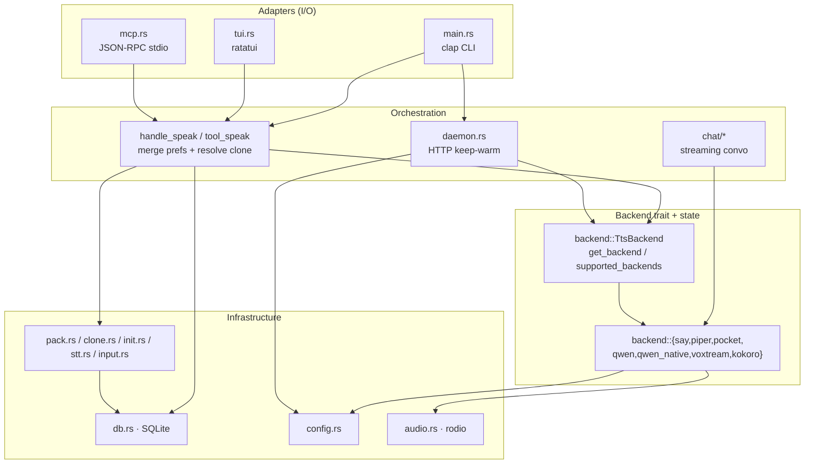
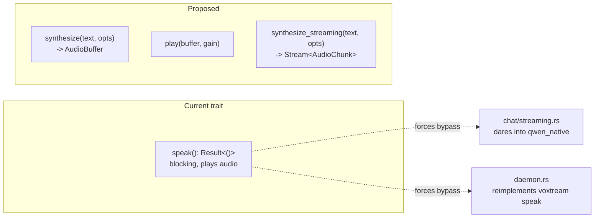
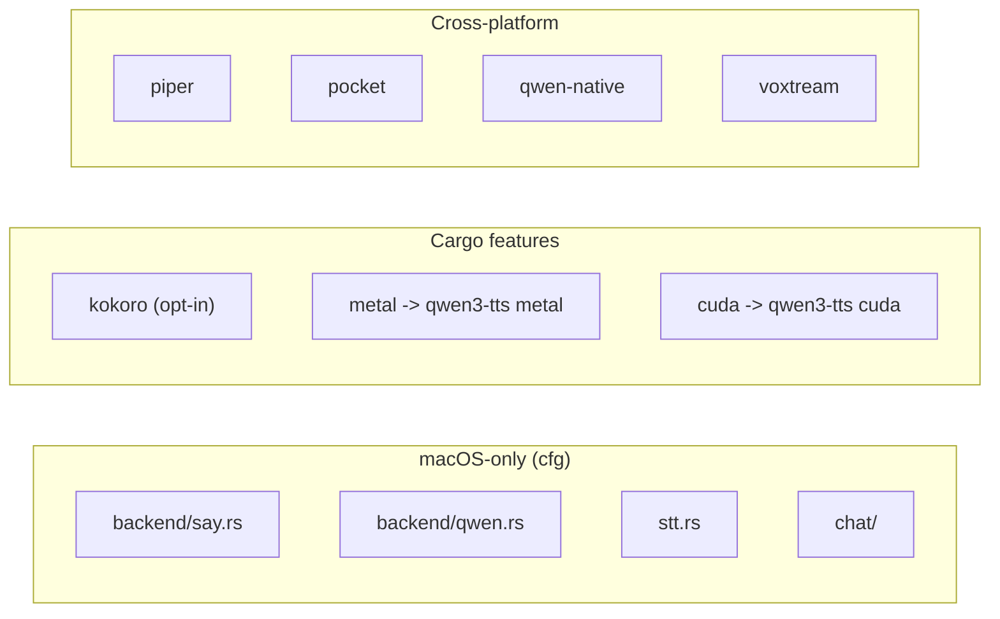

# Facet 1 — Architecture & Code Organization

**Subject:** `rtk-ai/vox` @ `9597c2f` (review) + post-daemon-hardening working tree (verified)
**Lens:** module graph, layering, the backend trait, cohesion/coupling, structural smells.

> **Verification pass:** 2026-08-02. All `file:line` citations re-checked against the
> current working tree (which now includes the daemon-auth + cold-start work). Items
> marked `[VERIFIED]` were re-confirmed present; `[STALE]` citations have been updated
> to current line numbers; `[CHANGED]` items were affected by subsequent work and are
> annotated.

---

## 1. Layered model

vox follows a clean **4-layer** shape. CLI/TUI/MCP are thin adapters over a shared orchestration core, which in turn drives the backend trait + persistence layer. No adapter reaches into a backend's internals directly.



**Verdict:** layering is healthy. Adapters never import backend internals (e.g. `mcp.rs` only touches `backend::get_backend` + `SpeakOptions`). The dependency arrows point downward consistently.

---

## 2. Module dependency map

Concrete intra-crate imports (from `use crate::…` / `use super::…`):

```mermaid
%%{init: {"theme": "default"}}%%
flowchart LR
    main[main.rs] --> backend
    main --> config
    main --> clone & db & init & input & mcp & pack & tui & daemon & chat & stt
    mcp --> backend
    mcp --> clone
    mcp --> db
    mcp --> pack
    mcp --> stt
    mcp --> config
    daemon --> audio
    daemon --> backend::voxtream
    daemon --> backend
    daemon --> config
    tui --> backend
    tui --> config
    tui --> db
    chat::streaming --> qwen_native
    chat::streaming --> stt
    chat::streaming --> db
    chat::mod --> backend
    chat::mod --> db
    backend::piper --> config
    backend::piper --> audio
    backend::pocket --> config
    backend::pocket --> audio
    backend::qwen --> audio
    backend::voxtream --> audio
    backend::voxtream --> config
    backend::kokoro --> config
    backend::qwen_native --> audio
    db --> config
    clone --> config
    clone --> db
    pack --> audio
    pack --> config
    init -.-> (std/serde only)
```

**Observations**
- ✅ No cycles. `config` and `audio` are leaf utilities with no internal deps — correct.
- ⚠️ `[VERIFIED]` `daemon.rs` reaches **through** the backend abstraction to `backend::voxtream::{find_voxtream, default_prompt_audio}` (`daemon.rs:32,213,304,696` — was `:24,:458`). This pierces the layer: the daemon "knows" voxtream internals rather than going through `TtsBackend`. That coupling is why voxtream's server management lives in `daemon.rs` instead of `backend/voxtream.rs`.
- ⚠️ `[VERIFIED]` `chat::streaming` likewise reaches into `backend::qwen_native::with_model` directly (`streaming.rs:13,283,349`) — the streaming loop calls `model.synthesize_with_voice` instead of `TtsBackend::speak`, because the trait is **blocking + returns `()`, not a buffer**. This is the trait's main limitation (see §4).
- ✅ `[VERIFIED]` `init.rs` is a pure std/serde module — easy to test, no `crate::` deps. Best-cohesion module in the crate.

---

## 3. Module cohesion scorecard

| Module | LOC | Cohesion | Coupling | Notes |
|---|--:|---|---|---|
| `main.rs` | 1053 | medium | high | Dispatcher; also holds `handle_*` business logic (stats formatting, bench, init orchestration) — could split. |
| `mcp.rs` | 1074 | medium | high | God-ish module: protocol + 14 tool impls + tests in one file. Functionally cohesive but large. |
| `daemon.rs` | 1039 | low-medium | **very high** | HTTP server + voxtream lifecycle + client + CLI handlers + Python WS script template. 4 concerns, 1 file. Grew ~50% after the daemon-hardening work (auth, body cap, graceful shutdown, cold-start helpers). |
| `tui.rs` | 509 | high | medium | Clean MVC-ish split (`App` model + `draw`/`run_loop`). |
| `chat/streaming.rs` | 394 | high | high | One job (streaming pipeline), but reaches into qwen_native. |
| `db.rs` | 333 | **high** | low | Pure data layer. Best module. |
| `init.rs` | 316 | **high** | low | Pure JSON/TOML injection. |
| `backend/*` | ~1358 | high | low | Each backend independent. (kokoro 295, qwen 262, piper 254, pocket 194, voxtream 163, qwen_native 133, say 59, mod 88.) |
| `audio.rs` | 106 | high | low | Tiny, focused. |
| `pack.rs` | 226 | medium | low | Carries both install + play; RNG weakness here. |

**Smell:** `daemon.rs` and `mcp.rs` are the two files most likely to grow unbounded. `mcp.rs` already has 14 tool handlers inline with the protocol framing. A `mcp/tools/*.rs` split (one file per tool or per group) would keep it navigable.

---

## 4. The backend trait — design & critique

```rust
// src/backend/mod.rs:48-53
pub trait TtsBackend {
    fn name(&self) -> &str;
    fn speak(&self, text: &str, opts: &SpeakOptions) -> Result<()>;
    fn list_voices(&self) -> Result<Vec<String>>;
    fn is_available(&self) -> bool;
}
```

**Strengths**
- Minimal contract — adding a backend is ~150 LOC.
- Selection is a pure runtime match (`get_backend`, `backend/mod.rs:70-88`); the `supported_backends()` function (`mod.rs:57-68`) is the single source of truth used by DB validation, TUI, and bench.
- `SpeakOptions` is a flat option-bag; backends ignore fields they don't support. Pragmatic.

**Weaknesses**
1. **`speak` returns `Result<()>` and is blocking + plays audio itself.** This forces every non-trivial consumer to bypass it:
   - `chat/streaming.rs` calls `model.synthesize_with_voice` directly because it needs the **samples** (for crossfade) and **non-blocking** playback. The trait can't express "synthesize to buffer".
   - The daemon's voxtream path reimplements the speak flow in `daemon.rs:453-498`.
   
   A richer trait would split `synthesize(text, opts) -> AudioBuffer` from `play(buffer)` — letting the CLI do `synthesize → gain → play` and the streamer do `synthesize → crossfade → queue`. Today that pipeline exists **only** inside the streaming chat.
2. **No `async`** in the trait, but `kokoro`'s underlying API is async (`kokoro.rs:55-66` wraps it in a `block_on` shim). Async backends have to fight the sync trait.
3. **`is_available()`** is synchronous and can be expensive (voxtream spawns `voxtream --help` on every call, `voxtream.rs:58-67`; qwen spawns `python3 -c import mlx_audio`, `qwen.rs:254-261`). Called in the `bench` loop (`main.rs:966-984`) — fine — but also conceptually a "probe", not a property. A `Probe` separate trait or a cached `OnceLock<bool>` would be cleaner.
4. **`list_voices()`** returns inconsistent shapes: piper returns model names (`"en_US-lessac-medium"`), qwen-native returns the string `"(use voice clones with --voice)"` (`qwen_native.rs:126`), voxtream returns a help string (`voxtream.rs:155`). These are not machine-parseable uniformly.



---

## 5. The `speak` orchestration duplication

`handle_speak` (`main.rs:277-365` — was `272-360`) and `tool_speak` (`mcp.rs:482-625` — was `482-598`) implement **the same** resolution algorithm (merge CLI/MCP args > DB prefs > lang defaults; resolve clone; auto-switch to clone-capable backend; build `SpeakOptions`; dispatch). They are ~80 LOC each and have already drifted:

- `[VERIFIED — STILL BROKEN]` `main.rs:309` (was `:304`) checks `["qwen","qwen-native","voxtream","pocket"]` for clone capability; `mcp.rs:545` still checks only `"qwen" && "qwen-native"` — **pocket/voxtream clones via MCP silently switch to qwen-native and lose the clone.** This divergence bug was *not* touched by the subsequent daemon work; it remains open. → fixed by **R1**.
- `[CHANGED — PARTIALLY FIXED]` The second point — "the daemon path is only used from the CLI, not from MCP" — **no longer holds.** The daemon-hardening work added `is_heavy_backend()` + `ensure_running()` routing to `tool_speak` (`mcp.rs:589-607`), so MCP now routes heavy backends through the warm daemon too. The daemon-routing divergence is closed; the clone-set divergence (above) is not.

A single `fn resolve_and_speak(source, args) -> SpeakOutcome` in a shared module would kill this duplication and the drift with it. High-value refactor.

---

## 6. Structural smells catalog

| # | Smell | Location | Severity |
|---|---|---|---|
| A1 | **God module**: `mcp.rs` mixes JSON-RPC framing + 14 tools + tests | `mcp.rs` (1074 LOC) | medium |
| A2 | **Leaky abstraction**: daemon imports `backend::voxtream` internals | `daemon.rs:32,213,304,696` (was `:24`) | medium |
| A3 | **Leaky abstraction**: streaming imports `qwen_native::with_model` | `streaming.rs:13,283,349` | medium |
| A4 | **Duplicated orchestration**: `handle_speak` ≈ `tool_speak`; clone-set diverged (pocket/voxtream dropped by MCP) | `main.rs:309`, `mcp.rs:545` (was `main.rs:304`) | **high** |
| A5 | **Hardcoded French** in chat module (SYSTEM_PROMPT, greeting, farewell) + CLAUDE.md template | `chat/mod.rs:15`, `chat/streaming.rs:72,137`, `init.rs:21-47` | medium |
| A6 | **Magic constants** duplicated: `120` chunk size in two files (both already `const`, but separately defined) | `backend/qwen.rs:20`, `chat/sentence.rs:2` (was `:4`) | low |
| A7 | **`unsafe` env-set** behind a misleading SAFETY comment | `piper.rs:58-62` (was `:58-63`) | medium (see Facet 3) |
| A8 | **TUI backend list is a stringly-typed table** parsed via `split_whitespace().next()` | `tui.rs:53-65,70,130,180` (was `:127-133`) | low |
| A9 | **`lib.rs` doc-comment is stale** ("Four backends", "14 tools") | `lib.rs:1-5` | low (docs) |
| A10 | **Two truth sources** for default backend: `config::DEFAULT_BACKEND="pocket"` vs `default_backend_for_lang` vs TUI list | `config.rs:5,10`, `tui.rs` | low |

> `[VERIFIED 2026-08-02]` All ten smells remain present at the updated line numbers. A4's clone-set divergence is the only one with user-visible behavioral impact (lost clones on pocket/voxtream via MCP).

---

## 7. Platform gating

vox uses `#[cfg(target_os = "macos")]` aggressively and correctly:



The `get_backend` match (`mod.rs:70-88`) `[VERIFIED]` mirrors this exactly with non-macOS arms giving a helpful "only available on macOS" bail. ✅ Consistent.

One nit: `lib.rs:9-10` and `lib.rs:19-20` `[VERIFIED]` gate `pub mod chat` / `pub mod stt` on macOS, but `main.rs`'s `Commands::Chat`/`Hear` (`main.rs:106,116` → dispatch at `253-256`) are *also* `#[cfg(target_os="macos")]` — correct, but the two must stay in sync manually; a build with one without the other would fail to compile. No test guards this coupling.

---

## 8. Recommendations (ranked)

| # | Action | Effort | Why |
|---|---|---|---|
| R1 | Extract `speak::resolve_and_speak(...)` shared by CLI + MCP | M | Eliminates the high-severity clone-handling divergence (A4) |
| R2 | Split `TtsBackend::speak` into `synthesize -> AudioBuffer` + free `play` | M | Removes the two leaky-abstraction bypasses (A2, A3); unlocks true streaming |
| R3 | Move voxtream server lifecycle out of `daemon.rs` into `backend/voxtream.rs` | S | Restores layering (A2); daemon should be backend-agnostic |
| R4 | Split `mcp.rs` into `mcp/protocol.rs` + `mcp/tools/*.rs` | M | Navigability (A1) |
| R5 | Replace TUI stringly-typed backend rows with `(name, label)` tuples | XS | Removes `split_whitespace` parse fragility (A8) |
| R6 | Centralize magic constants (`MIN_CHUNK_CHARS`) in one `const` | XS | (A6) |
| R7 | Add a compile-time test that `Commands` cfg mirrors `lib.rs` mod cfg | XS | Catches macOS gating drift |

> `[STATUS 2026-08-02]` None of R1–R7 have been implemented yet. R1 (resolve the A4 clone-set divergence) remains the highest-value open item — it's a live behavioral bug (pocket/voxtream clones dropped on the MCP path), not just structure. The daemon-routing half of §5's second bullet was incidentally resolved by the daemon-hardening work.

---

## 9. Bottom line

The architecture is **sound and idiomatic** for a Rust CLI: clear layers, a clean backend trait, good separation of persistence (db) from policy (config) from mechanism (backends). The two structural debts that will hurt as the project grows are (a) the **too-thin backend trait** that forces every advanced consumer to bypass it, and (b) the **duplicated speak-orchestration** between CLI and MCP that has already produced one behavioral divergence. Neither is hard to fix; both are worth fixing before the next major feature lands.

> **Verification summary (2026-08-02):** Re-checked every citation against the post-daemon-hardening working tree. The layering analysis (§1–§4, §7) is fully intact; only line numbers shifted (updated in place). The single **still-live behavioral bug** is A4's clone-set divergence (`main.rs:309` vs `mcp.rs:545`) — pocket/voxtream clones are silently dropped when invoked via MCP. The daemon-routing divergence flagged in the original §5 is now resolved. All ten smells (A1–A10) remain present.
