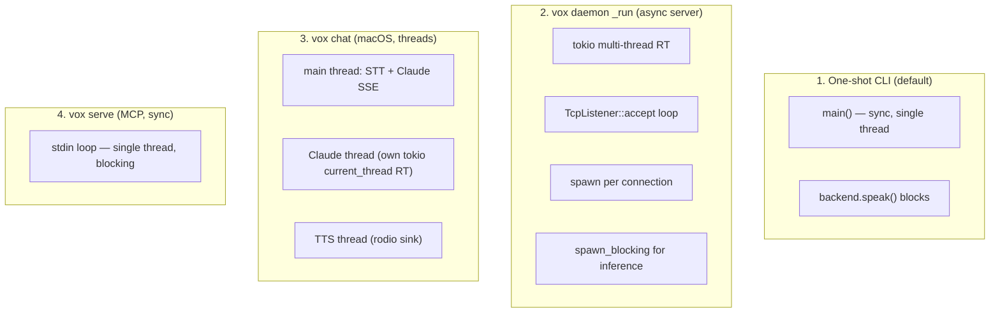
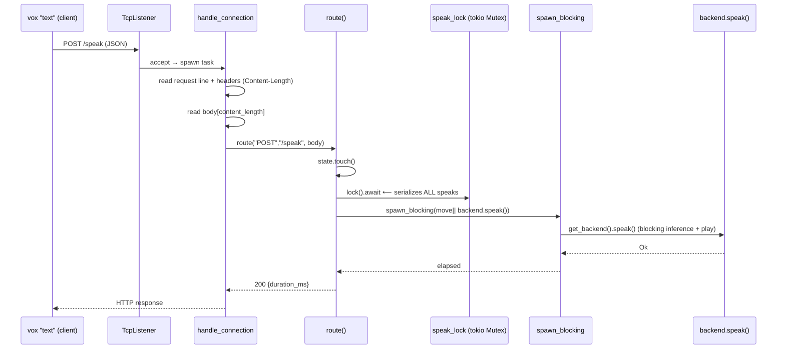
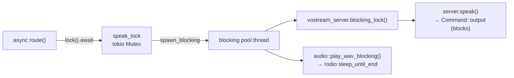
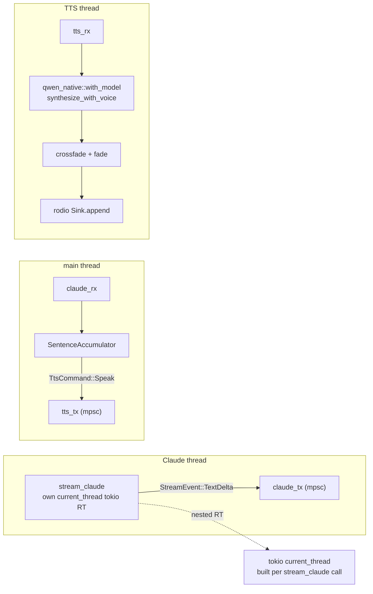
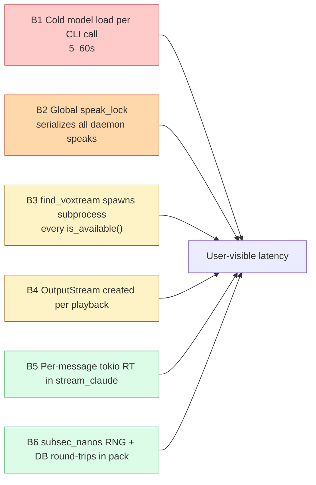

# Facet 3 — Concurrency, Async & Daemon Performance

**Subject:** `rtk-ai/vox` @ `9597c2f`
**Lens:** daemon architecture, tokio usage, lock discipline, blocking-in-async, streaming pipeline, races/deadlocks, performance bottlenecks.

---

## 1. The concurrency landscape

vox runs in **three distinct runtime modes**, each with its own concurrency story:



This is the source of most concurrency findings: **four modes, three concurrency models** (sync, tokio multi-thread, OS threads + nested tokio). They do not share an abstraction.

---

## 2. Daemon architecture

`daemon.rs` is a hand-rolled HTTP/1.1 server on a tokio `TcpListener`. State:

```rust
// daemon.rs:265-270
struct DaemonState {
    start_time: Instant,
    last_request: AtomicU64,
    speak_lock: Mutex<()>,                 // tokio::sync::Mutex
    voxtream_server: Mutex<Option<VoxtreamServer>>,
}
```



### 2.1 What's good

- ✅ Inference correctly offloaded via `spawn_blocking` (`daemon.rs:453,515`) — never blocks the tokio reactor on model math.
- ✅ Atomic idle-watchdog with `Relaxed` ordering (`daemon.rs:282-288,344-353`) — correct and cheap.
- ✅ `Connection: close` on every response keeps the HTTP parser simple and avoids keep-alive bugs.

### 2.2 Concurrency-correctness findings

| # | Finding | Location | Severity |
|---|---|---|---|
| CN1 | **Global speak lock serializes every request.** `let _lock = state.speak_lock.lock().await;` (`daemon.rs:437`) is acquired for *all* `/speak` calls, including non-voxtream ones. This means two concurrent `vox_speak` requests for two different backends (e.g. piper + pocket) cannot run in parallel even though they touch disjoint state. Throughput ceiling = 1. | `daemon.rs:437` | **high** (perf) |
| CN2 | **Mixing `tokio::sync::Mutex` and `blocking_lock()`.** `DaemonState::voxtream_server` is a `tokio::sync::Mutex`, but inside `spawn_blocking` the code calls `state_clone.voxtream_server.blocking_lock()` (`daemon.rs:468`). `blocking_lock` panics if called from an async context *without* `block_in_place` on a multi-threaded runtime — here it's inside `spawn_blocking` (a blocking-pool thread), so it's *legal*, but it's a footgun. The two-lock dance (`speak_lock` then `voxtream_server.blocking_lock()`) is lock-ordering-fragile. | `daemon.rs:437,468` | medium |
| CN3 | **No request body size cap.** `let mut body = vec![0u8; content_length];` (`daemon.rs:393-396`) trusts the `Content-Length` header verbatim. A `Content-Length: 4000000000` → 4 GB allocation. Local-only mitigates but any local user can DoS the daemon. | `daemon.rs:380-396` | **high** |
| CN4 | **No auth on the daemon.** Binds `127.0.0.1:19876` (`daemon.rs:336`). Any process/user on the machine can POST `/speak` (drive the speakers / waste GPU) or POST `/shutdown`. No token, no UID check. `is_running()` is unauthenticated (`daemon.rs:71-77`). | `daemon.rs:336,539` | **high** |
| CN5 | **`#[derive]` PoisonError handling is manual** — `Mutex::lock().map_err(poisoned)` is used consistently (`pocket.rs:92`, `qwen_native.rs:27`, `piper.rs:160`). Good. ✅ But `tokio::sync::Mutex` does *not* poison; the std `Mutex` in backends does. Mixing models means a panic during inference poisons the backend `Mutex` (correctly reported), but the daemon's `speak_lock` does not. Asymmetric. | various | low |
| CN6 | **Watchdog uses `std::process::exit(0)`** (`daemon.rs:350,544`) — skips `Drop`. The `VoxtreamServer` child is *not* killed on idle-timeout shutdown (its `Drop` is bypassed by `exit`). Orphaned `voxtream-server` process results. | `daemon.rs:255-261,350` | medium |
| CN7 | **Single-threaded accept handling for HTTP parsing.** The HTTP request-line/header loop (`daemon.rs:371-391`) runs in the async task; it's not CPU-heavy so OK, but `read_exact` for the body (`daemon.rs:395`) is awaited — fine. The real bottleneck is CN1. | `daemon.rs:367-408` | info |
| CN8 | **HTTP parser is naive:** reads until blank line, trusts `Content-Length` only, ignores chunked transfer-encoding, no method/path validation beyond string match. A malformed request can spin the header loop if a client sends headers without a blank line (mitigated by TCP EOF, but slowloris-shaped). | `daemon.rs:381-391` | medium |

---

## 3. Blocking-in-async audit

Every `reqwest::blocking` call in the crate (`grep`):

| Location | Context | Safe? |
|---|---|---|
| `daemon.rs:72` (`is_running`) | called from **sync** client code in `main.rs`/`handle_start` | ✅ |
| `daemon.rs:175` (voxtream health poll) | inside `spawn_blocking` (`VoxtreamServer::start`) | ✅ |
| `daemon.rs:573` (`speak_via_daemon`) | sync client (`main.rs:342`) | ✅ |
| `daemon.rs:638,666` (`handle_stop/status`) | sync client | ✅ |
| `pack.rs:92` (`reqwest::blocking::Client`) | sync CLI path only | ✅ |
| `chat/claude_api.rs:78` (`call_claude`) | sync helper, kept-for-compat; not used by streaming | ✅ |
| `backend/piper.rs:133,146` (`reqwest::blocking::get`) | runs in `backend.speak()` → may be inside daemon `spawn_blocking` ✅, but **also inside MCP `serve` which is fully sync** ✅ | ✅ |

So the blocking-call audit is **clean** — no `blocking::` call is awaited directly inside an async fn. The danger is the *reverse*: `kokoro.rs:45-53`'s `block_on` shim calling `block_in_place` from within (potentially) a single-threaded runtime — see Facet 2 KK2.



`audio::play_wav_blocking` blocks the **blocking-pool thread** until playback finishes — correct use of `spawn_blocking`, but it means each speak occupies a blocking-pool worker for the full audio duration. The default tokio blocking pool is 512 threads, so this is fine in practice.

---

## 4. Lock discipline summary

| Lock | Type | Scope | Held across await? | Held across blocking? |
|---|---|---|---|---|
| `DaemonState::speak_lock` | `tokio::sync::Mutex<()>` | entire `/speak` route | **yes** (across `spawn_blocking.await`) | n/a |
| `DaemonState::voxtream_server` | `tokio::sync::Mutex<Option<VoxtreamServer>>` | `ensure_voxtream_server` + WS speak | yes (`await`ed in `ensure`) | yes (`blocking_lock` in `spawn_blocking`) |
| `pocket::MODEL` | `std::sync::Mutex<Option<TTSModel>>` | model load + generate + play | n/a (sync) | **yes — held across `model.generate` AND `audio::play`** ⚠️ |
| `qwen_native::MODEL` | `std::sync::Mutex<Option<Qwen3TTS>>` | model load + synthesize | n/a | held across `synthesize` only ✅ |
| `piper::MODEL` | `std::sync::Mutex<Option<(lang,Piper)>>` | load + create | n/a | held across `model.create` only ✅ |

⚠️ **`pocket.rs:169-176`**: the model `Mutex` guard is held across `model.generate` **and then across `audio::play_wav_blocking`** — wait, re-reading: `with_model(|model| { … generate … write_wav })` releases the guard, *then* `apply_wav_gain`/`play_wav_blocking` run outside (`pocket.rs:178-179`). ✅ Actually fine — the guard is scoped to the closure. Good.

The one genuine concern is CN1: the daemon's coarse `speak_lock`.

---

## 5. Streaming chat pipeline (`chat/streaming.rs`)

A 3-thread design: main (STT + sentence accumulate), Claude (nested current-thread tokio for SSE), TTS (rodio sink). Channels: `StreamEvent` main←Claude, `TtsCommand` main→TTS.



| # | Finding | Location | Severity |
|---|---|---|---|
| ST1 | **Per-call tokio runtime in `stream_claude`** (`claude_api.rs:104-108`): builds a `new_current_thread().enable_all()` runtime for *every* Claude turn. Runtime construction is not free; building one per chat message is wasteful but not catastrophic. | `claude_api.rs:104` | medium |
| ST2 | **SSE line buffer is unbounded.** `line_buf.push_str(...)` accumulates bytes that never contain `\n` (`claude_api.rs:142-151`). A misbehaving proxy could stream megabytes without a newline. Cap it. | `claude_api.rs:142` | medium |
| ST3 | **`[DONE]` sentinel handling**: Anthropic SSE doesn't send `[DONE]` (that's OpenAI). The code checks for both `[DONE]` and `message_stop` (`claude_api.rs:157,175`). Harmless but the `[DONE]` branch is dead for Anthropic. | `claude_api.rs:157` | info |
| ST4 | **No cancellation.** If the user presses Ctrl-C mid-response, the Claude thread keeps streaming and the TTS sink keeps playing until natural end. `record_until_enter` reads stdin blocking (`chat/mod.rs:61-76`); there's no signal to tear down the pipeline. | `chat/mod.rs:61`, `streaming.rs` | medium |
| ST5 | **Crossfade correctness is excellent.** `crossfade_into` blends prev-tail × cos with current-head × sin over `CROSSFADE_MS` samples (`streaming.rs:46-54`). Equal-power crossfade, mathematically sound. The held-back tail (`streaming.rs:299-306`) avoids double-playing the overlap region. ✅ | `streaming.rs:26-54` | info |
| ST6 | **`mpsc::Sender::send` errors are ignored** (`let _ = tts_tx.send(...)`). If the TTS thread dies, the main thread keeps accumulating silently. Acceptable for a chat toy; would want logging in production. | `streaming.rs:203,210` | low |
| ST7 | **`Speaker::Ryan` is hardcoded** in the non-clone streaming path (`streaming.rs:285`). The user's `--voice` / prefs.voice is ignored when not using a clone. | `streaming.rs:285` | medium |
| ST8 | **Greeting/farewell/exit strings are French-only** hardcoded (`streaming.rs:72,137`; `chat/mod.rs:15` SYSTEM_PROMPT is French). Conflicts with the MCP layer's careful language detection (`mcp.rs:47-78`). | `chat/mod.rs:15`, `streaming.rs:72` | medium |

---

## 6. Tokio runtime config vs usage

`Cargo.toml` enables: `rt`, `rt-multi-thread`, `net`, `io-util`, `macros`, `signal`, `time`.

| Feature | Used where | Verdict |
|---|---|---|
| `rt-multi-thread` | `main.rs:926` (`Runtime::new()`) for daemon | ✅ needed for `spawn_blocking` + multi task |
| `net` | `TcpListener` in daemon | ✅ |
| `io-util` | `BufReader`, `AsyncReadExt` in daemon | ✅ |
| `macros` | none directly (`#[tokio::main]` not used) | ⚠️ possibly unused — `main()` is sync and builds RT manually |
| `signal` | **not used** — daemon shutdown is via HTTP `/shutdown` + watchdog | ⚠️ dead feature; could wire SIGTERM for clean Drop (CN6) |
| `time` | `sleep` in watchdog + delayed shutdown | ✅ |

**Findings:**
- TG1 `signal` is enabled but unused (`Cargo.toml:21`). Wiring `tokio::signal::ctrl_c()` → graceful shutdown would fix CN6 (orphaned voxtream-server). **medium**
- TG2 `macros` appears unused; if `#[tokio::main]` is never used it can be dropped to shrink compile time slightly. **low**

---

## 7. Performance bottlenecks (ranked)



| Rank | Bottleneck | Fix | Effort |
|---|---|---|---|
| 1 | Cold start per CLI invocation | persistent daemon (auto-start) or expand daemon to be the default path | L |
| 2 | `speak_lock` global serialization | per-backend locks, or drop the lock entirely (backends have their own) | S |
| 3 | Daemon body allocation trusts Content-Length | cap at e.g. 1 MB | XS |
| 4 | `find_voxtream` subprocess probe | `OnceLock<Option<PathBuf>>` | XS |
| 5 | Per-call `OutputStream` | long-lived stream in daemon | M |
| 6 | Per-message tokio RT | one runtime for the chat loop | S |

---

## 8. Race / deadlock analysis

- **Lock ordering:** daemon acquires `speak_lock` → (voxtream path) `voxtream_server.blocking_lock()`. Single order, no inverse acquisition → **no deadlock**. ✅
- **Backend `std::Mutex` + tokio `Mutex` mix:** backend `Mutex` is only ever acquired inside `spawn_blocking`, never held across `.await`. ✅
- **`record_until_enter`** (`chat/mod.rs:61-76`): spawns `rec`, reads stdin, then `child.kill()`/`wait()`. If `read_line` blocks forever and the user walks away, the `rec` process leaks. No timeout. ⚠️ **low-medium**.
- **MCP `serve` is single-threaded** (`mcp.rs:118-161`) — reads stdin line-by-line, processes synchronously, writes stdout. No shared state, no races. ✅ But this means a long `vox_speak` **blocks all other MCP tool calls** — an AI assistant issuing parallel `tools/call` will serialize. The MCP spec allows the server to be slow, but a 60-second voxtream speak stalls everything. **medium**.

---

## 9. Recommendations (ranked)

| # | Action | Effort | Addresses |
|---|---|---|---|
| R1 | Cap daemon request body (reject Content-Length > N) | XS | CN3 |
| R2 | Add auth token to daemon (write random token to PID file, client must send it) | S | CN4 |
| R3 | Drop global `speak_lock`; use per-backend locks or none | S | CN1 |
| R4 | Wire `tokio::signal::ctrl_c()` for graceful daemon shutdown (kill child, flush) | S | CN6, TG1 |
| R5 | Bound the SSE line buffer; bail on overflow | XS | ST2 |
| R6 | Honor `--voice` in non-clone streaming path; localize chat strings | S | ST7, ST8 |
| R7 | Add Ctrl-C cancellation to the chat pipeline | M | ST4 |
| R8 | Reuse one tokio runtime across chat turns | XS | ST1 |
| R9 | Cache `find_voxtream`/`is_available` in `OnceLock` | XS | B3 |
| R10 | Consider running MCP `tools/call` on a thread pool to allow concurrency | M | §8 |

---

## 10. Bottom line

Concurrency in vox is **mostly correct but coarse**. The async/sync boundary is respected (no blocking-in-async hotspots found), the streaming crossfade is mathematically sound, and poison errors are handled. The real problems are **performance-shaped, not safety-shaped**: a global speak lock that serializes the daemon, a body allocator that trusts headers, no auth on a localhost-bound server that can drive hardware, and — biggest of all — a process model that makes every CLI call cold-start the model. R1–R4 are a day's work and meaningfully tighten the daemon; the cold-start story (R in Facet 2) is the strategic item.
