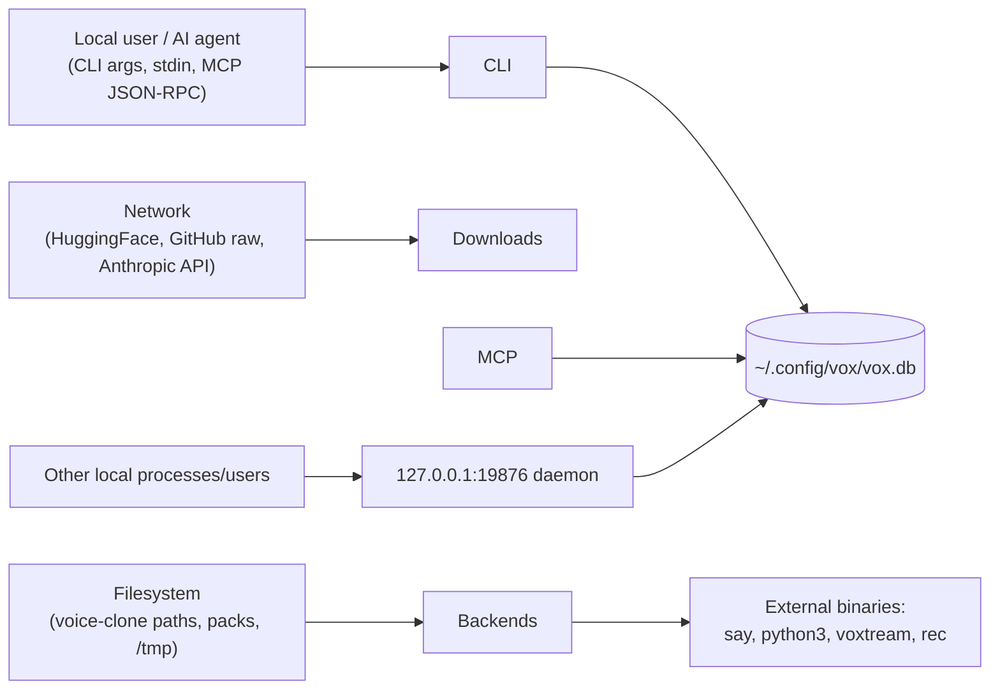
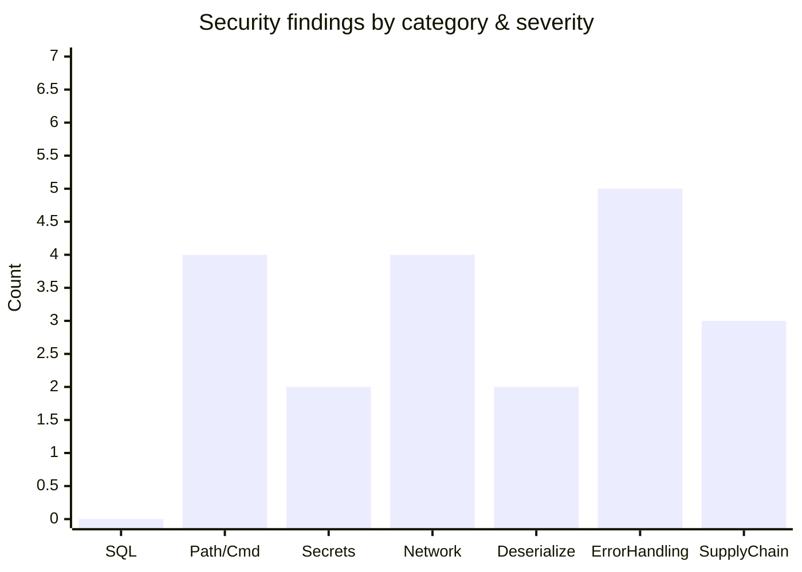

# Facet 4 — Security, Error Handling & Input Validation

**Subject:** `rtk-ai/vox` @ `9597c2f`
**Lens:** SQL safety, path/command traversal, secret handling, network surface, deserialization, error discipline, resource exhaustion, supply chain.

---

## 1. Threat model

Trust boundaries: (a) CLI/MCP args are **untrusted**; (b) the daemon port is reachable by any local user; (c) downloaded model/pack content is partially trusted (executed as model input, not code — except voxtream's Python script); (d) the Anthropic API key is a high-value secret.

---

## 2. Severity rollup

vox's **SQL story is exemplary** (zero findings) and its **path/command story is mostly strong** — most of the surface is the local daemon and the voxtream Python bridge.

---

## 3. SQL injection — clean

Every query uses bound parameters (`?N`) and `rusqlite::params![]`. Verified each:

| Function | Query style | Verdict |
|---|---|---|
| `set_preference` | whitelist key → `format!("UPDATE preferences SET {key} = ?1")`. **Key is whitelisted** (`db.rs:124-132`) before interpolation — value is bound. | ✅ safe (the *only* place user text reaches SQL text, and it's guarded) |
| `add_clone` | `params![name, ref_audio, ref_text]` | ✅ |
| `get_clone` | `[name]` | ✅ |
| `list_clones` / `remove_clone` | bound | ✅ |
| `log_usage` | `params![backend, voice, lang, …]` | ✅ |
| all stats queries | static SQL, no interpolation | ✅ |

`tests/security_test.rs:11-51` actively injects `'; DROP TABLE …` into values, names, backends — all stored literally, tables intact. **No SQL injection.**

> Note: the one string-interpolated SQL is `set_preference`'s `UPDATE … SET {key}`, but `key` is validated against a hardcoded 8-element array (`db.rs:124-132`) before reaching `format!`. This is safe *as written* and is tested (`security_test.rs:57-75`). It would become unsafe if the whitelist were ever loosened — consider an explicit `match` returning a static `&str` per key to make it compile-time safe.

---

## 4. Path traversal / command injection

### 4.1 External command invocation — no shell

Verified every `std::process::Command` in the crate. **None** use `sh -c`; all pass args separately. `tests/security_test.rs:206-225` asserts `python3` (not `sh`) for STT and that single-quote escaping is applied.

| Site | Command | Args safe? |
|---|---|---|
| `say.rs:14-24` | `/usr/bin/say` | ✅ text as one arg |
| `qwen.rs:23-48` | `python3 -m mlx_audio.tts.generate --text <text>` | ✅ text is a single arg, not shell |
| `voxtream.rs:115-135` | `voxtream -t <text> -o <wav> …` | ✅ |
| `stt.rs:11-23` | `python3 -c <inline script>` | ⚠️ script built by `format!` with `audio_path.replace('\'`, "\\'")` — see SE1 |
| `clone.rs:52-57` / `chat/mod.rs:62-67` / `main.rs:488` | `rec <path> …` | ✅ arg-based |
| `daemon.rs:239-243` | `python3 -c <generated WS script>` | ⚠️ **SE2 — JSON built by string format** |

### 4.2 Findings

| # | Finding | Location | Severity |
|---|---|---|---|
| SE1 | **STT inline-Python single-quote escaping is incomplete.** `stt.rs:14-19` does `audio_path.replace('\'`, "\\'")` inside a single-quoted Python string. A path containing `\\'` (backslash-quote) still breaks out. Real risk is low (paths are usually benign) but the pattern is fragile. Prefer passing the path via `sys.argv` or stdin. | `stt.rs:14-19` | medium |
| SE2 | **voxtream WebSocket client JSON is built by `format!`** with only `"`-escaping (`daemon.rs:195-229`). A `ref_audio` path containing `\"` (backslash-quote) breaks the JSON string, allowing injection into the `event`/`text`/`prompt_audio_path` fields that the Python server consumes. Build the JSON with `serde_json::to_string` and inject the resulting string, or pass via stdin. | `daemon.rs:195-229` | **high** |
| SE3 | **`record_clone` writes `<name>.wav` with no sanitization.** `clone.rs:66` does `clones_dir().join(format!("{name}.wav"))`. A clone name of `../../etc/cron.d/evil` traverses out of `~/.config/vox/clones/`. There is **no test** for `record_clone` with a malicious name (the DB-layer tests don't exercise the filesystem write). | `clone.rs:63-66` | **high** |
| SE4 | **`/tmp/vox_hear_input.wav` and `/tmp/vox_chat_input.wav` use fixed names.** `mcp.rs:939`, `main.rs:483`, `chat/streaming.rs:117`. World-writable dir, predictable name → **symlink attack** (another user pre-creates the path → overwrite/arbitrary-file-read via the recorded content) and **cross-process collision** (two parallel `vox hear` clobber each other). Use `tempfile::NamedTempFile` or `mkstemp`. | three sites | **high** |
| SE5 | `validate_audio` checks extension + existence only — a `.wav`-named arbitrary file passes (`clone.rs:33-50`). Backend then fails deep inside the model. Low impact (denial of useful error) but the validation gives false confidence. | `clone.rs:33-50` | low |

---

## 5. Secret handling

| # | Finding | Location | Severity |
|---|---|---|---|
| SC1 | **`ANTHROPIC_API_KEY` is read from env** (`main.rs:453`) and stored in `ChatConfig.api_key` (`chat/mod.rs:34`), cloned into the Claude thread (`streaming.rs:178`). It is sent only to `api.anthropic.com` over HTTPS with `x-api-key` header (`claude_api.rs:81,128`). ✅ Not logged, not persisted. | `claude_api.rs` | ✅ |
| SC2 | **`HF_TOKEN`** read from env for pocket voice-cloning weights (`pocket.rs:57-59`). Used by the `pocket-tts` crate's HF hub client. vox itself does not log it. ✅ But: vox **prints to stderr** which weights it's using based on token presence (`pocket.rs:97-101`) — does not leak the token, just the fact of its presence. | `pocket.rs:97` | ✅ |
| SC3 | **API key never written to DB or config files.** Confirmed: `Preferences` has no key field (`db.rs:11-21`). ✅ | `db.rs` | ✅ |
| SC4 | **Error messages can echo user input.** E.g. `Unknown backend: {name}` (`backend/mod.rs:86`), `failed to load reference audio: {path}` (`qwen_native.rs:95`). User-controlled, but only reflected to the same user's stderr/stdout. No injection vector (no shell, no HTML). Acceptable. | various | info |
| SC5 | **`init.rs` writes an `env: {}` block** into every MCP config (`main.rs:561-564`). If vox ever needs an env var (e.g. `HF_TOKEN`) for a backend, it would have to be added there — currently empty, so no secret lands in MCP config files. ✅ but worth a note: don't put secrets in that block. | `main.rs:563` | info |

---

## 6. Network surface

| # | Finding | Location | Severity |
|---|---|---|---|
| NW1 | **Daemon binds `127.0.0.1:19876` with no authentication.** Any local user/process can `POST /speak` (drive speakers, burn GPU, run voxtream), `POST /shutdown` (DoS), or `GET /health`. Port is configurable via `VOX_DAEMON_PORT`. There is **no token, no UID check, no SO_PEERCRED**. | `daemon.rs:32-37,336` | **high** |
| NW2 | **No TLS verification override** — vox uses reqwest defaults (TLS verified) for HF, GitHub, Anthropic. ✅ No `danger_accept_invalid_certs` anywhere. | reqwest usage | ✅ |
| NW3 | **Downloads (piper ONNX, kokoro, packs) have no integrity check.** No checksum, no signature. `piper.rs:133`, `pack.rs:124-140`, `kokoro.rs` (via error message only). A compromised CDN/repo or a CA-level MITM → arbitrary bytes written to disk and (for piper/kokoro) loaded as an ONNX model (ONNX runtime has had RCE CVEs historically). | piper/kokoro/pack | medium |
| NW4 | **`reqwest::blocking::get(url).bytes()` reads entire body into memory** with no size cap (`piper.rs:133,146`; packs `pack.rs:136`). A malicious/compromised server could OOM the process. | piper/pack | medium |
| NW5 | **Anthropic SSE: error body read with `unwrap_or_default()`** (`claude_api.rs:137`) — safe. Non-2xx bodies are surfaced in the error string (`claude_api.rs:138`) which could include echo of the request, but no key. ✅ | `claude_api.rs:136-139` | ✅ |
| NW6 | **`packs_repo` is a `raw.githubusercontent.com` URL over HTTPS** (`pack.rs:17`) — pinned to `main` branch, not a commit/tag. A malicious PR merged to `tonyyont/peon-ping` flows to all vox users immediately. Pin to a commit SHA. | `pack.rs:17` | medium |

---

## 7. Deserialization safety

| Site | Input | Safe? |
|---|---|---|
| MCP `serde_json::from_str(line)` (`mcp.rs:132`) | stdin from AI client | ✅ malformed → `-32700` error, no panic |
| Daemon `serde_json::from_slice(body)` (`daemon.rs:428`) | network body | ✅ malformed → 400 |
| `pack.rs:107` manifest parse | downloaded JSON | ✅ `?` propagated |
| `config.rs:111-127` `models.toml` parse | user file | ✅ falls back to bundled on invalid |
| `claude_api.rs:162` `serde_json::from_str::<SseData>` | network SSE | ✅ `let Ok(event) = … else continue` — malformed events skipped, no panic |

**Deserialization is uniformly safe** — serde's derived `Deserialize` is panic-free and errors are propagated. ✅

The one deserialization-adjacent concern is the **MCP tool-speak text truncation** (`mcp.rs:592-594`): `&text[..77]` slices **bytes**, not chars. For multi-byte UTF-8 (CJK, emoji) this slices mid-codepoint and **panics** (`byte index … is not a char boundary`). This is a **Critical** correctness bug (not a memory-safety bug — Rust catches it at runtime, but it's a panic on attacker-controllable input: any MCP `vox_speak` with Chinese text > 77 bytes crashes the MCP server).

> `src/mcp.rs:592` — **CRITICAL** — fix: `text.chars().take(77).collect::<String>()` or `text.get(..77).unwrap_or(&text)` with a char-boundary-safe truncate.

---

## 8. Error handling discipline

- vox uses `anyhow` throughout with `.context(...)` — good practice. Errors are user-readable.
- **`unwrap()`/`expect()`/`panic!` count in `src/`: 9** (per `grep`). Of those:
  - 4 are in **test code** (`claude_api.rs:197,199,207`) — fine.
  - 2 are `.as_ref().unwrap()` after a `is_none()`-then-fill guard (`pocket.rs:108`, `qwen_native.rs:33`) — safe by construction but could be `expect("invariant: model just loaded")` for clarity.
  - 2 are `.unwrap()` on `as_object_mut().context(...)?`-guaranteed JSON objects (`init.rs:222,277`) — safe but fragile.
  - 0 are on user input. ✅

| # | Finding | Location | Severity |
|---|---|---|---|
| EH1 | **MCP UTF-8 byte slice panic** (above) | `mcp.rs:592` | **critical** |
| EH2 | `now_epoch_secs().duration_since(UNIX_EPOCH).unwrap_or_default()` (`daemon.rs:317-322`) — safe ✅ | daemon | ✅ |
| EH3 | `load_models_config().expect("bundled models.toml is invalid")` (`config.rs:126`) — panics if the bundled file is malformed. Build-time include guarantees it; acceptable but a `const` parse at build time would be safer. | `config.rs:126` | low |
| EH4 | Daemon `route()` returns `&'static str` status — `404` for unknown paths is fine, but there is no `405 Method Not Allowed` for e.g. `GET /speak`. Minor. | `daemon.rs:416-553` | info |
| EH5 | Errors from `db::log_usage` are silently dropped (`let _ = …`) in `main.rs:350` and `mcp.rs:581`. Acceptable (logging is best-effort) but a debug-level log would help. | `main.rs:350`, `mcp.rs:581` | info |

---

## 9. Resource exhaustion

| # | Finding | Severity |
|---|---|---|
| RE1 | Daemon body allocation trusts `Content-Length` (CN3, Facet 3) | **high** |
| RE2 | piper/pack downloads have no size cap (NW4) | medium |
| RE3 | SSE line buffer unbounded (ST2, Facet 3) | medium |
| RE4 | No limit on `text` length in `vox_speak` — a 100 MB text is accepted, passed to the backend, and (for say) handed to `/usr/bin/say` as one arg. ARG_MAX will reject it, but vox doesn't pre-validate. | low |
| RE5 | `tests/security_test.rs:339-365` proves 1 MB clone names / 100 KB prefs / 1 M-char usage logs don't crash — good defensive coverage at the DB layer. ✅ | ✅ |

---

## 10. Supply chain

`Cargo.toml` has two **git dependencies** — the highest supply-chain risk in the crate:

| Dependency | Source | Pinned? | Risk |
|---|---|---|---|
| `qwen3-tts` | `git = "https://github.com/TrevorS/qwen3-tts-rs"` (`Cargo.toml`) | **❌ no `rev`/`tag`** | Next `cargo update` silently pulls whatever `main` is today — code execution at build time (build scripts), and behavioral drift. **Critical for reproducibility.** |
| `piper-rs` | `git = "https://github.com/thewh1teagle/piper-rs"` | **❌ no `rev`/`tag`** | same |

All other deps are crates.io versions. Spot-check of `Cargo.lock` shows the git deps resolved to specific commits *now*, but without `rev =` in `Cargo.toml`, a fresh clone + `cargo update` floats.

| # | Finding | Severity |
|---|---|---|
| SP1 | Pin both git deps to a `rev` or `tag` | **critical** |
| SP2 | No `cargo audit` in CI → known-RustSec advisories undetected | high |
| SP3 | No `cargo deny`/license check → a future GPL dep could land in the tree unnoticed (vox is Apache-2.0) | medium |
| SP4 | `packs_repo` points to `main` of a third-party repo (`tonyyont/peon-ping`) — pin to a commit | medium |
| SP5 | No SBOM/provenance in releases (no `cosign`, no SLSA) | low |

---

## 11. Summary table — all security findings

| ID | Severity | Finding | Location |
|---|---|---|---|
| EH1 | **Critical** | MCP byte-slice panic on multi-byte UTF-8 | `mcp.rs:592` |
| SP1 | **Critical** | Two git deps unpinned → non-reproducible, code-at-build-time risk | `Cargo.toml` |
| SE2 | High | voxtream WS JSON built by `format!` → JSON injection shape | `daemon.rs:195-229` |
| SE3 | High | `record_clone` unsanitized name → path traversal | `clone.rs:63-66` |
| SE4 | High | Fixed-name `/tmp` recording files → symlink/collision | `mcp.rs:939`, `main.rs:483`, `streaming.rs:117` |
| NW1 | High | Daemon no auth on localhost port | `daemon.rs:336` |
| RE1 | High | Daemon trusts Content-Length → OOM | `daemon.rs:393` |
| SP2 | High | No `cargo audit` in CI | `.github/workflows/ci.yml` |
| SE1 | Medium | STT inline-Python incomplete escaping | `stt.rs:14-19` |
| NW3 | Medium | No integrity check on downloads | piper/kokoro/pack |
| NW4 | Medium | Unbounded download bodies | `piper.rs:133`, `pack.rs:136` |
| NW6 | Medium | `packs_repo` on `main` branch | `pack.rs:17` |
| RE3 | Medium | Unbounded SSE buffer | `claude_api.rs:142` |
| SP3 | Medium | No license/advisory gate | CI |
| SE5 | Low | `validate_audio` extension-only | `clone.rs:33` |
| RE4 | Low | No text-length pre-validation | `mcp.rs:482` |
| EH3 | Low | `expect` on bundled toml | `config.rs:126` |

---

## 12. Recommendations (ranked, with effort)

1. **Pin git deps** (`rev=`) — XS — kills SP1.
2. **Fix MCP UTF-8 slice** — XS — kills EH1.
3. **`record_clone` sanitize name + test** — XS — kills SE3.
4. **`tempfile` for record paths** — XS — kills SE4.
5. **Daemon: auth token + body cap** — S — kills NW1, RE1.
6. **voxtream WS client via serde JSON + stdin** — S — kills SE2.
7. **`cargo audit` + `cargo deny` in CI** — S — kills SP2, SP3.
8. **Pin `packs_repo` to a SHA** — XS — kills NW6.
9. **STT via `sys.argv`** — XS — kills SE1.
10. **Stream downloads with size cap + sha256** — M — kills NW3, NW4.

---

## 13. Bottom line

vox has a **genuinely strong** security foundation on the path most projects get wrong: parameterized SQL everywhere, whitelist-validated inputs, no shell invocation, an active injection/traversal test suite, and careful secret handling. The findings concentrate in three places: (1) **two panicky/injection-shaped codegen patterns** (MCP byte slice, voxtream JSON, STT Python) that are one-line fixes each; (2) **the localhost daemon's missing auth + unbounded body**, which widens the attack surface to any local user; (3) **supply-chain hygiene** (unpinned git deps, no audit). None are remotely exploitable without local access, and the SQL/path/core-input validation is first-rate. Closing the top 7 items is roughly a day's work and would move this facet from "6.5" to "8.5".
