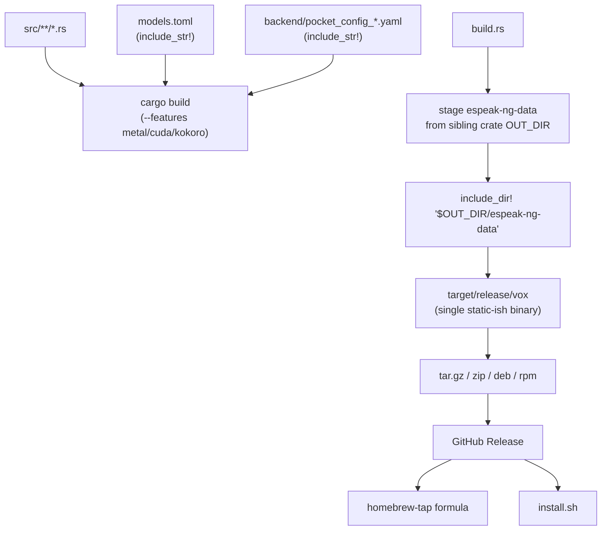
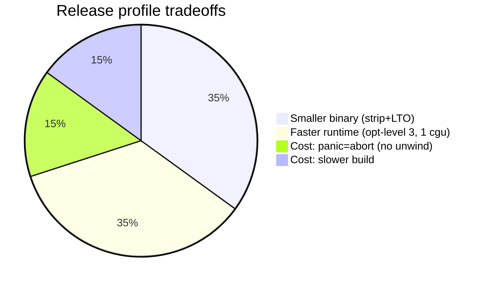
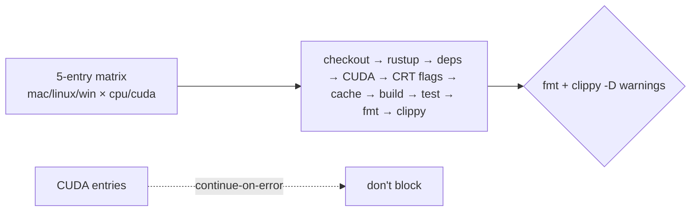
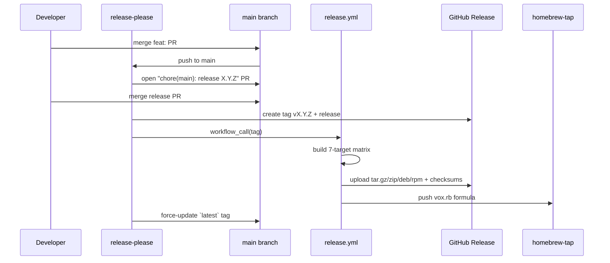

# Facet 5 — Build, CI/CD & Release Engineering

**Subject:** `rtk-ai/vox` @ `9597c2f`
**Lens:** Cargo manifest, feature flags, build.rs, CI matrix, release pipeline, Homebrew, install.sh.

---

## 1. Build system overview



vox is a single-crate Rust project (`Cargo.toml` `[package]`, no workspace). Three build-time concerns: two `git` dependencies, one custom `build.rs`, and a heavy release matrix.

---

## 2. Cargo manifest analysis

### 2.1 Dependencies (24 runtime + 3 dev)

| Dep | Version | Pinned? | Purpose | Notes |
|---|---|---|---|---|
| clap | 4 | ✅ | CLI parsing | derive |
| anyhow | 1 | ✅ | error handling | — |
| rusqlite | 0.32 | ✅ | SQLite | `bundled` — good for distributable |
| dirs | 6 | ✅ | config paths | — |
| reqwest | 0.12 | ✅ | HTTP | `blocking,json,stream` — note: pulls both blocking + async |
| tokio | 1 | ✅ | async runtime | see Facet 3 §6 |
| futures-util | 0.3 | ✅ | stream | only for SSE |
| serde / serde_json | 1 | ✅ | (de)ser | — |
| tempfile | 3 | ✅ | temp files | — |
| rodio | 0.20 | ✅ | audio playback | — |
| hound | 3 | ✅ | WAV read/write | — |
| **qwen3-tts** | **git** | ⚠️ no `rev=` in Cargo.toml | qwen-native backend | locked in `Cargo.lock` to `711ceee0…`; floats on `cargo update` |
| **piper-rs** | **git** | ⚠️ no `rev=` in Cargo.toml | piper backend | locked in `Cargo.lock` to `616e6823…`; floats on `cargo update` |
| include_dir | 0.7 | ✅ | embed espeak-ng-data | — |
| kokoro-tts | 0.3 | ✅ | kokoro backend | optional |
| toml | 0.8 | ✅ | models.toml | — |
| ratatui / crossterm | 0.29 / 0.28 | ✅ | TUI | — |
| pocket-tts | 0.6.2 | ✅ | pocket backend | — |
| sys-locale | 0.3 | ✅ | MCP lang detection | — |
| assert_cmd / predicates / tempfile | 2 / 3 / 3 | ✅ | dev | — |

**Dep count:** 611 entries in `Cargo.lock` (transitive). Large but expected for a binary pulling candle/ort/rodio.

### 2.2 The git-dep pinning nuance

`Cargo.toml` declares the two git deps **without** `rev`/`tag`:
```toml
qwen3-tts = { git = "https://github.com/TrevorS/qwen3-tts-rs", features = ["hub"], default-features = false }
piper-rs   = { git = "https://github.com/thewh1teagle/piper-rs" }
```
Because `Cargo.lock` is committed and pins both to specific commits (`711ceee0…`, `616e6823…`), **builds are reproducible today** as long as `--locked` is used. The risk is:
- A contributor running `cargo update` silently advances to upstream `main` → behavioral/build-script drift.
- `Cargo.toml` alone (without `Cargo.lock`) does not capture intent.
- CI does **not** build with `--locked` (see §4).

**Recommendation:** add `rev = "<sha>"` to both, or `tag = "…"`. Effort XS, removes ambiguity. (Reclassified from "Critical" in the draft to "High" given the lockfile is present — but still the single highest-value hygiene fix.)

### 2.3 `reqwest` blocking+async dual feature

`reqwest = { version = "0.12", features = ["blocking", "json", "stream"] }` pulls both the blocking and async client into the same binary. This is legitimate (CLI client uses blocking, Claude SSE uses async) but **inflates compile time and binary size** — the async hyper/tonic machinery is linked even though only `stream_claude` uses it. Could not be avoided without splitting crates; acceptable.

---

## 3. Feature flags & profile

### 3.1 Features

```toml
[features]
default = []
kokoro = ["kokoro-tts"]
metal = ["qwen3-tts/metal", "qwen3-tts/accelerate"]
cuda = ["qwen3-tts/cuda"]
```

| Flag | Effect | Gating correct? |
|---|---|---|
| `kokoro` | enables `backend::kokoro` module + dep | ✅ `mod.rs:6-7,60-61,72-73` all `#[cfg(feature="kokoro")]` |
| `metal` | forwards to qwen3-tts | ✅ only meaningful on macOS |
| `cuda` | forwards to qwen3-tts | ✅ |

**Off-path:** `say`, `qwen`, `chat`, `stt` are gated on `target_os="macos"` not on a feature. Correct. The default build (`cargo build` with no features) compiles on all platforms with piper + pocket + qwen-native + voxtream. ✅

### 3.2 Release profile

```toml
[profile.release]
opt-level = 3
lto = true
codegen-units = 1
panic = "abort"
strip = true
```

- `lto=true` + `codegen-units=1` → max optimization, slow build, smaller/faster binary. ✅ appropriate for a distributable CLI.
- `panic = "abort"` → smaller binary, but means any `unwrap`/slice-panic **terminates the process** with no unwind. This **elevates the severity of EH1** (MCP byte-slice panic) and the model-`Mutex` poison risk: with `panic=abort`, a panic in one tool call kills the whole MCP server (and, in the daemon, kills the daemon + orphans voxtream-server). Worth a sentence in CONTRIBUTING.
- `strip = true` → smaller binary, but **removes panic location info** — user stack traces become useless. Acceptable tradeoff for size; consider a separate `profile.release-debug` for power users.



---

## 4. `build.rs`

The build script (`build.rs`) locates `espeak-ng-data` built by the sibling `espeak-rs-sys` crate, copies it into vox's `OUT_DIR`, so `include_dir!` can embed it. This solves a real problem (espeak-ng bakes a build-machine path that doesn't exist post-install).

| # | Finding | Location | Severity |
|---|---|---|---|
| BR1 | **Hard `panic!` if espeak-ng-data not found** (`build.rs:25-32`). Correct behavior, but the error message doesn't suggest causes (out-of-order build, stale `target/`). Friendly message would help. | `build.rs:25` | low |
| BR2 | `find_espeak_data` picks the **newest** `espeak-rs-sys-*` dir by mtime (`build.rs:72-91`). If two espeak versions are in the tree, mtime is a weak signal. Hash/name match would be more deterministic. | `build.rs:72-91` | low |
| BR3 | `copy_dir_recursive` resolves symlinks (`build.rs:93-110`) — good, handles espeak's symlinked data. ✅ | `build.rs:93-110` | ✅ |
| BR4 | `cargo:rerun-if-changed` is set for `build.rs` and the data dir (`build.rs:14,40`) but **not** for `pocket_config_b6369a24.yaml` / `models.toml` (embedded via `include_str!`, which Cargo auto-tracks). ✅ | build.rs | ✅ |

---

## 5. CI (`ci.yml`)

### 5.1 Matrix

| Entry | OS | Features | CUDA | Special |
|---|---|---|---|---|
| macOS (Metal) | macos-latest | metal | — | — |
| Linux (CPU) | ubuntu-latest | (none) | — | libasound2-dev |
| Linux (CUDA) | ubuntu-latest | cuda | ✅ best-effort | `continue-on-error` |
| Windows (CPU) | windows-latest | (none) | — | `/MD` CRT fix |
| Windows (CUDA) | windows-latest | cuda | ✅ best-effort | `continue-on-error` |



### 5.2 CI findings

| # | Finding | Severity |
|---|---|---|
| CI1 | **No `--locked` on build/test** (`ci.yml:85,90`). Builds can silently advance transitive deps against a stale lockfile-or-not. Add `--locked` to catch lockfile drift. | medium |
| CI2 | **No `cargo audit` / `cargo deny`.** Supply-chain advisories and license issues go undetected (Facet 4 SP2/SP3). | high |
| CI3 | **`fmt --check` skipped on CUDA entries** (`ci.yml:95`) — fine (those are best-effort), but fmt only runs on 3 of 5 entries. Coverage gap is cosmetic since formatting is platform-independent. | low |
| CI4 | **Clippy runs on all entries with `-D warnings -A clippy::collapsible_if -A clippy::collapsible_match`** (`ci.yml:99`). The two allows are reasonable (those lints fight `let`-chains the codebase uses). ✅ | ✅ |
| CI5 | **No coverage reporting** (`tarpaulin`/`llvm-cov`). Given the good test suite (Facet 6), coverage tracking would surface the untested daemon/MCP paths. | medium |
| CI6 | **Cache key** `${{ runner.os }}-${{ matrix.features }}-cargo-${{ hashFiles('**/Cargo.lock') }}` (`ci.yml:82`). Good — invalidates on lockfile change. But Windows+CUDA and Windows+CPU share `runner.os=Windows` + `features=""`/`"cuda"` → distinct keys. ✅ | ✅ |
| CI7 | **CUDA best-effort via `continue-on-error`** with an honest comment about GH-hosted runner kernel mismatch (`ci.yml:17-20`). Pragmatic. ✅ But means CUDA build health is invisible — flaky upstream won't be noticed until a release. | medium |
| CI8 | **No MSRV check.** Edition 2024 (`Cargo.toml:4`) requires Rust 1.85+. CI uses `stable` (dtolnay/toolchain) — fine, but no `rust-version` field in manifest and no MSRV CI matrix. | low |
| CI9 | **`Jimver/cuda-toolkit@v0.2.22`** pinned to a specific version. ✅ Good supply-chain hygiene on the action itself (better than the git deps!). | ✅ |
| CI10 | Tests that drive audio (`say`, `rec`, rodio) run in CI headless — these are `#[cfg(target_os="macos")]` gated (e.g. `cli_test.rs:36`) and on Linux runners rodio's `try_default()` may fail without a device. **Potential flake source** — see Facet 6. | medium |

---

## 6. Release pipeline

`release-please` (v4) on push to main → release PR → tag → triggers `release.yml` (reusable workflow) → matrix build → upload assets → Homebrew formula push.



### 6.1 Build matrix (`release.yml`)

| Target | OS | Features | Packages |
|---|---|---|---|
| `aarch64-apple-darwin` | macos-latest | metal | — |
| `x86_64-unknown-linux-gnu` | ubuntu-latest | — | deb+rpm |
| `aarch64-unknown-linux-gnu` | ubuntu-24.04-arm | — | deb+rpm |
| `x86_64-unknown-linux-gnu` (cuda) | ubuntu-latest | cuda | — |
| `x86_64-pc-windows-msvc` | windows-latest | — | — |
| `x86_64-pc-windows-msvc` (cuda) | windows-latest | cuda | — |

Note: **Intel Mac (`x86_64-apple-darwin`) explicitly removed** (`release.yml:40-41`) because ort has no prebuilt binaries for it. Documented decision. ✅

### 6.2 Release findings

| # | Finding | Severity |
|---|---|---|
| RL1 | **`cargo build --release` without `--locked`** (`release.yml:102`). Same as CI1; reproducibility relies on the committed lockfile but isn't enforced. | medium |
| RL2 | **Checksums generated** (`sha256sum * > checksums.txt`, `release.yml:173-176`). ✅ Good — and Homebrew formula verifies them. | ✅ |
| RL3 | **No binary signing/provenance.** No `cosign`/SLSA/provenance attestation. Industry baseline is shifting toward SLSA; vox ships unsigned binaries with checksums only. | medium |
| RL4 | **Homebrew formula `desc` is stale** — says "three backends" (`release.yml:223`). Also references an **Intel-Mac `on_intel` branch** with a `vox-x86_64-apple-darwin.tar.gz` URL and `SHA_INTEL_PLACEHOLDER` (`release.yml:228-231,260`) — but that target is **no longer built** (RL above). The `grep aarch64-apple-darwin`/etc. parsing (`release.yml:211-214`) won't find an Intel entry, leaving the placeholder literally in the formula → `brew install` will fail the SHA check on Intel Macs. **High** for Intel-Mac Homebrew users. | **high** |
| RL5 | **`aarch64-unknown-linux-gnu` builds on `ubuntu-24.04-arm`** (native, `release.yml:49-55`) — no cross-compile. ✅ Correct (earlier commit `8db035c` removed broken cross-compile). | ✅ |
| RL6 | **deb/rpm generated only for native Linux targets** (`release.yml:121-130`, copies `target/<triple>/release/vox` → `target/release/vox` so cargo-deb/generate-rpm find it). Slightly hacky but documented. ✅ | ✅ |
| RL7 | **No CHANGELOG automation beyond release-please** — release-please maintains `CHANGELOG.md` from conventional commits. ✅ (`CHANGELOG.md` is present, 10 KB.) | ✅ |
| RL8 | **`gh release upload … --clobber`** (`release.yml:179`) — re-runs overwrite. Combined with `continue-on-error` on CUDA entries, a successful CUDA re-run would replace a previously-uploaded CPU asset name? No — artifact_suffix `-cuda` disambiguates. ✅ | ✅ |
| RL9 | **`update-latest-tag` force-moves a `latest` git tag** (`release-please.yml:48-66`). Mutates git state on every release. Common pattern but can confuse consumers pinning to `latest` (SHA changes under them). Documented behavior would help. | low |

---

## 7. `install.sh` audit

POSIX `sh`, `set -e`, 162 LOC.

| # | Finding | Severity |
|---|---|---|
| IS1 | **`curl | sh` pattern** — inherent risk (no signature verification before exec). Mitigated slightly by `set -e` and GitHub HTTPS, but the script downloads a binary with **no checksum verification** (`install.sh:113-115`). A MITM or compromised release serves malware. **install.sh should download `checksums.txt` and verify.** | **high** |
| IS2 | `get_latest_version` hits `api.github.com/repos/.../releases/latest` and greps `tag_name` (`install.sh:65-70`). Works but rate-limited (60/hr unauth). A heavy CI behind one NAT could hit the cap. | low |
| IS3 | `can_sudo` checks `sudo -n true` then `/dev/tty` redirect (`install.sh:75-81`) — thoughtful handling of the `curl|sh` no-stdin case. ✅ | ✅ |
| IS4 | `place_binary` falls back to `~/.local/bin` when `/usr/local/bin` unwritable and no sudo (`install.sh:83-101`) — good UX. ✅ But doesn't warn that `~/.local/bin` may not be on `PATH` (the `verify()` step does warn). ✅ | ✅ |
| IS5 | **No `set -u`** — `set -e` only. `${VOX_INSTALL_DIR:-}` is used defensively (`install.sh:13`), so `set -u` would be safe to add for stricter error checking. | low |
| IS6 | **Windows only via WSL** (`install.sh:44`) — correct, the `*.msvc.zip` artifact exists for native Windows but install.sh is Unix-only. | info |
| IS7 | `tar -xzf` then `chmod +x` then `mv` (`install.sh:117-123`) — temp dir cleaned with `rm -rf` (`install.sh:125`). ✅ Uses `mktemp -d`. ✅ | ✅ |

---

## 8. Recommendations (ranked)

| # | Action | Effort | Addresses |
|---|---|---|---|
| R1 | Pin git deps with `rev=` in Cargo.toml | XS | §2.2 |
| R2 | Add `--locked` to CI + release builds | XS | CI1, RL1 |
| R3 | Add `cargo audit` + `cargo deny` CI job | S | CI2, SP2/3 |
| R4 | install.sh: download + verify checksums.txt before exec | S | IS1 |
| R5 | Fix Homebrew formula: remove Intel-Mac branch / update `desc` to "seven backends" | XS | RL4 |
| R6 | Add coverage (llvm-cov) + upload to CI | M | CI5 |
| R7 | Sign releases (cosign) + SLSA provenance | M | RL3 |
| R8 | Add MSRV (`rust-version`) + a `1.85` CI entry | XS | CI8 |
| R9 | Improve `build.rs` panic message; pin espeak match by name | XS | BR1/2 |

---

## 9. Bottom line

The build/release setup is **solid and pragmatic**: a sensible feature-flag scheme, an aggressive-but-appropriate release profile, a broad CI matrix with honest CUDA caveats, conventional-commits release automation, checksums, and Homebrew. The hygiene gaps are the ones that bite later: **two unpinned-in-manifest git deps**, **no `--locked`/`cargo audit`/`cargo deny`**, **no install.sh signature verification**, and a **stale Homebrew formula** that will break Intel-Mac installs. All are small fixes; R1–R5 are a half-day and would move this facet from "6.0" to "8.0".
