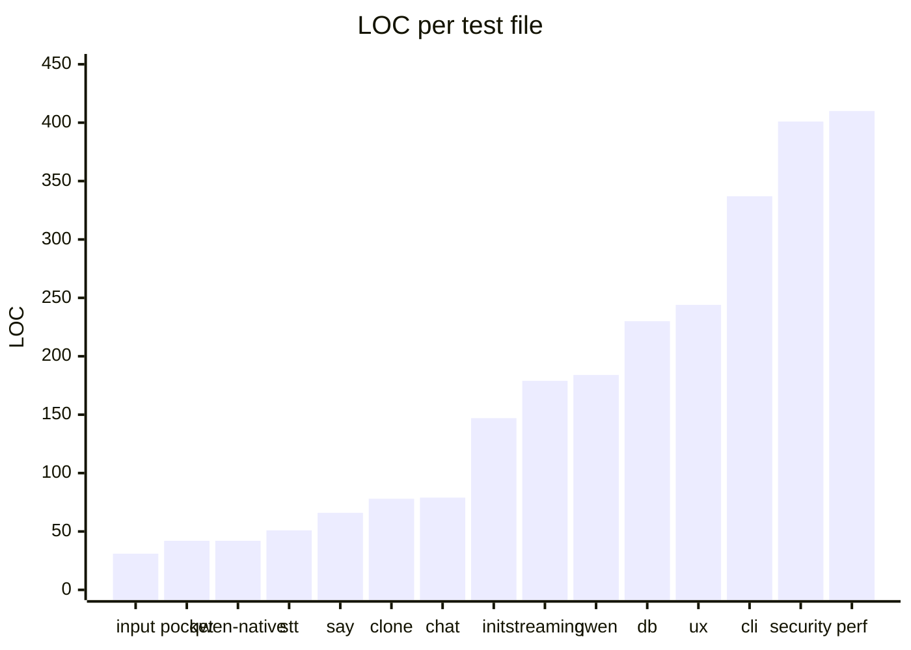
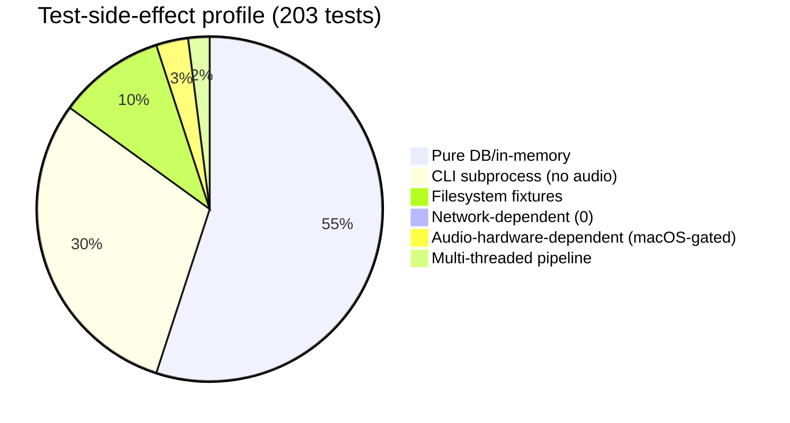

# Facet 6 — Testing & Quality Assurance

**Subject:** `rtk-ai/vox` @ `9597c2f`
**Lens:** coverage matrix, test quality, flakiness risk, gaps.

---

## 1. Test inventory

- **203 `#[test]` functions** across `tests/*.rs` + inline `#[cfg(test)] mod tests` in `src/`.
- **15 integration test files**, ~2,520 LOC.
- Plus inline unit tests in `mcp.rs` (5), `chat/sentence.rs` (7), `chat/claude_api.rs` (2).

The three biggest files (`perf_test.rs` 410, `security_test.rs` 401, `cli_test.rs` 337) are also the highest-quality.

---

## 2. Coverage matrix — module × tested?

| Module | Tested? | Quality | Notes |
|---|---|---|---|
| `db.rs` | ✅ strong | high | `db_test.rs` (230) + heavy `security_test`/`perf_test` coverage; CRUD, migration, aggregation, injection. Best-covered module. |
| `init.rs` | ✅ strong | high | `init_test.rs` (147); CLAUDE.md markers, settings merge, idempotency. |
| `input.rs` | ✅ | medium | `input_test.rs` (31); args + stdin + empty. |
| `chat/sentence.rs` | ✅ strong | high | 7 unit tests cover thresholds, multi-punct, streaming threshold. |
| `chat/claude_api.rs` | ✅ | medium | SSE parsing unit tests (2); no live-API test (correctly). |
| `chat/streaming.rs` | ✅ | high | `streaming_test.rs` (179) — excellent mock-SSE multi-thread pipeline test that asserts reconstruction + timing. |
| `clone.rs` | ⚠️ partial | medium | `validate_audio` well tested; **`record_clone` never tested** (filesystem write, the path-traversal risk SE3). |
| `config.rs` | ⚠️ light | medium | enums covered indirectly via `security_test`; no direct unit test of `load_models_config` override precedence. |
| `backend/*` (build cmds) | ⚠️ partial | medium | say/qwen/stt `build_*_command` asserted (args, program); **piper/voxtream/kokoro/pocket/qwen-native have zero tests** beyond `is_available`/`name`. |
| `pack.rs` | ❌ | — | No tests at all. Install/play/RNG untouched. |
| `audio.rs` | ❌ | — | No tests. `apply_wav_gain` rounding (AU2), `play_wav_*` untested. |
| `daemon.rs` | ❌ | — | 694 LOC, **zero tests**. HTTP parser, routing, voxtream lifecycle, idle watchdog — all untested. Highest-risk gap. |
| `mcp.rs` | ⚠️ weak | low | 5 inline tests for `instructions`/`normalize_locale` only. **No test of the JSON-RPC dispatch, tool handlers, or the byte-slice truncation bug (EH1).** |
| `tui.rs` | ❌ | — | 509 LOC, no tests. Hard to test (terminal), but app-model logic (`set_idx`, `next_screen`) is pure and testable. |

---

## 3. Test quality assessment

### 3.1 Strengths

- **Real assertions, not smoke.** `security_test.rs` verifies *behavior* (table still exists after injection; value stored literally; null bytes round-trip). `perf_test.rs` asserts concrete latency budgets (< 100ms, < 50ms). `streaming_test.rs` asserts exact reconstruction + sentence count.
- **Property-ish coverage.** `db_test.rs` exercises overwrite, multi-key, invalid-key, migration-on-open. `security_test.rs` covers all 12 supported langs, all 5 audio extensions, boundary lengths (10 KB names, 100 KB prefs, 1 M-char logs).
- **Isolation discipline.** Every CLI test sets `VOX_DB_PATH` to a `tempfile` (`cli_test.rs:29`, etc.) — no shared state, no `~/.config/vox` pollution. ✅
- **`open_in_memory()`** for unit tests — no filesystem DB needed. ✅
- **Concurrency tested where it matters**: `streaming_test.rs` runs real threads + channels + timing.

### 3.2 Weaknesses

| # | Finding | Severity |
|---|---|---|
| T1 | **`daemon.rs` is the largest untested module** (694 LOC, 0 tests). The HTTP parser, `route()`, idle watchdog, voxtream lifecycle, and `VoxtreamServer` are all shipped on faith. An integration test that starts the daemon on a random port, POSTs `/health` and `/speak` (with a stub backend), would cover the core paths. | **high** |
| T2 | **`mcp.rs` protocol layer untested.** The JSON-RPC dispatch (`run_server`, `handle_tools_call`) and all 14 tool handlers have no integration test. A test feeding `initialize`/`tools/list`/`tools/call` lines via a pipe would catch EH1 and the divergence in `tool_speak` clone handling (Facet 1 §5). | **high** |
| T3 | **No test for the MCP UTF-8 truncation bug** (EH1). Add `tool_speak` with a 100-byte Chinese string → should not panic. | **critical** (the bug is critical; the test gap enables it) |
| T4 | **`pack.rs` entirely untested** — install/play/RNG (PK1). Mock the HTTP or test against a fixture manifest. | medium |
| T5 | **`audio.rs` untested.** `apply_wav_gain` is pure-ish (writes a file); trivially testable with a known WAV fixture. Would catch AU2 (DC bias) and the bit-depth-downcast behavior. | medium |
| T6 | **Flakiness risk from real audio hardware.** Tests like `cli_test.rs:36` (`--backend say --list-voices`) and any future `speak` test depend on `say`/rodio/device presence. Currently `say` tests are macOS-gated; rodio's `OutputStream::try_default()` will fail on a headless Linux CI without an audio device. No current test actually *plays* audio in CI (good), but adding such tests needs `PIPEWIRE_LATENCY`/dummy-sink setup. | medium |
| T7 | **`record_clone` (filesystem write) untested** — the SE3 path-traversal vector has no regression test. | medium |
| T8 | **No regression test for `vox init` MCP idempotency** — `cli_test.rs:296` tests CLI-mode idempotency, but not MCP-mode (the clobber bug, Facet 1). | medium |
| T9 | **Streaming chat tests are macOS-only** (`streaming_test.rs:1` `#![cfg(target_os="macos")]`) even though the pipeline code (`chat/streaming.rs`, `chat/sentence.rs`) is platform-neutral. The sentence accumulator + SSE tests could run on all platforms. | low |
| T10 | **No benchmark/regression tracking** — perf tests assert absolute budgets (< 100ms) but don't track trends. A slow CI runner can flake these (e.g. `bulk_usage_log_performance` < 1000ms for 1000 inserts). | low |

---

## 4. Test-runtime characteristics

- **Network-dependent tests: 0.** ✅ No test downloads models or hits Anthropic. Excellent — the suite is hermetic. `pocket_test.rs`/`qwen_native_test.rs` only assert `name()`/`is_available()` shape, never load a model.
- **Audio-hardware tests are gated** to macOS and limited to `--list-voices`. ✅ No CI flakiness from this today.
- **`bench` (live `handle_bench`) is untested** — it actually speaks audio, so correctly excluded from CI, but also has no test harness.

---

## 5. Gap-driven test recommendations

| # | Test to add | Catches | Effort |
|---|---|---|---|
| TR1 | `mcp.rs`: pipe `initialize`/`tools/list`/`tools/call vox_speak` with multi-byte UTF-8 text | EH1 (panic), tool dispatch | S |
| TR2 | `mcp.rs`: `tool_speak` with a voice-clone name on pocket → assert backend stays `pocket` | CLI/MCP divergence (Facet 1) | S |
| TR3 | `daemon.rs`: start on `VOX_DAEMON_PORT=<random>`, assert `/health` 200, POST `/speak` with `say` backend (macOS) or stub, POST oversized `Content-Length` → reject (after R3 fix) | daemon routing, body cap | M |
| TR4 | `pack.rs`: fixture manifest + temp dir, assert install/play; replace RNG, assert uniform-ish distribution | PK1, pack coverage | S |
| TR5 | `audio.rs`: fixture WAVs (int16, float32), assert `apply_wav_gain` output values; catch DC bias | AU2 | XS |
| TR6 | `clone.rs`: `record_clone` with name `"../evil"` → assert rejected/sanitized | SE3 | XS |
| TR7 | `init.rs`: MCP-mode `inject_mcp_server` called twice → assert no-op (not clobber) | init idempotency | XS |
| TR8 | `tui.rs`: unit-test `App::set_idx`/`next_screen`/`selected_*` pure logic | TUI model | S |
| TR9 | Ungate `chat/sentence.rs` + `chat/claude_api.rs` SSE tests to all platforms | cross-platform coverage | XS |
| TR10 | Add `cargo llvm-cov` to CI + threshold gate | trend tracking | M |

---

## 6. Bottom line

vox has a **genuinely good** test suite for the data and CLI layers — the security and perf test files are exemplars of behavioral assertion, and the streaming pipeline test is a model for testing concurrent code. The gaps are **structural and consequential**: the two largest/most complex modules (`daemon.rs`, `mcp.rs`) are essentially untested, which is exactly where the critical bugs (EH1, the clone-handling divergence) hide. Adding TR1–TR3 would catch the highest-severity findings in this entire review and is the single best ROI on test effort.
