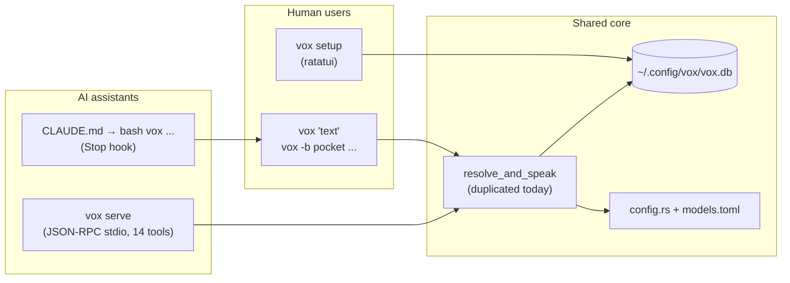
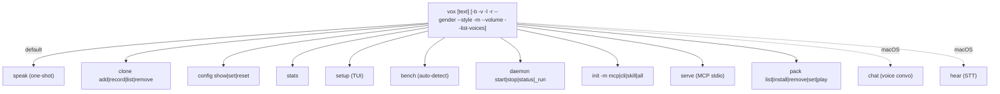
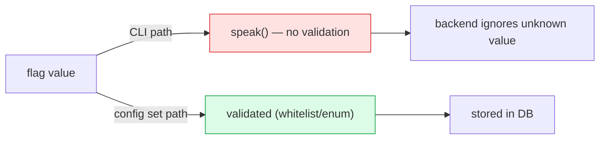
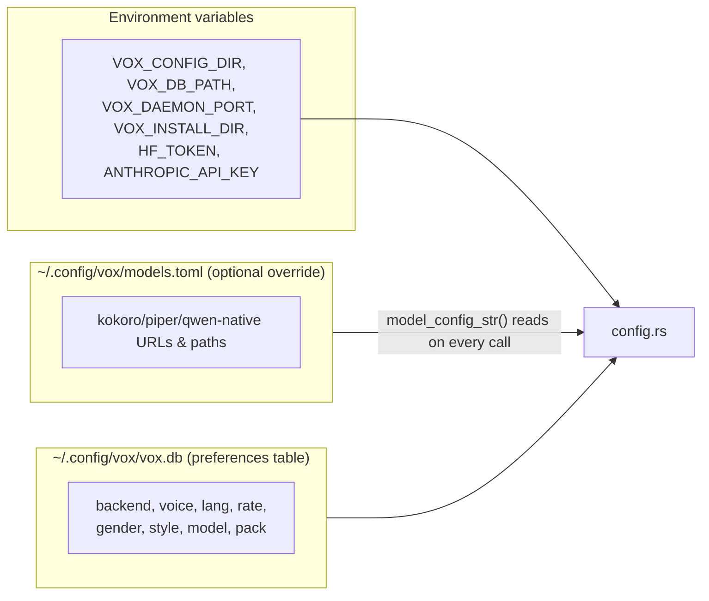
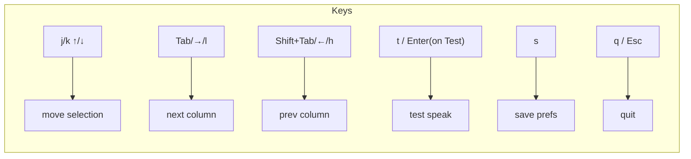
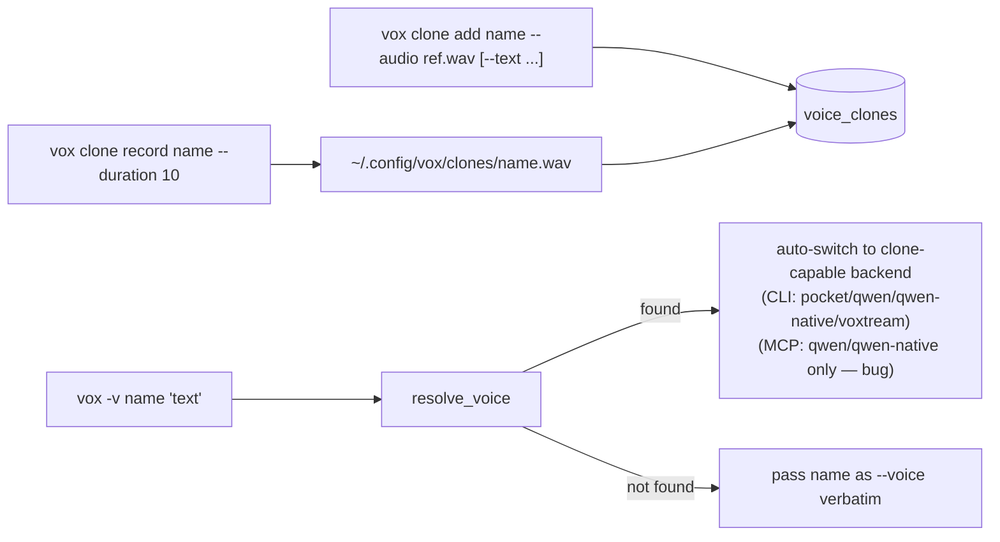

# Facet 7 — CLI, UX, Config & MCP Server

**Subject:** `rtk-ai/vox` @ `9597c2f`
**Lens:** CLI surface & flags, the interactive TUI, configuration model, the MCP server protocol/UX, voice-clone UX, accessibility.

---

## 1. The user-facing surface

vox exposes four human/AI entry points over a shared core:



---

## 2. CLI (`main.rs`)

### 2.1 Command tree



A flat, clap-derived CLI with one optional positional (`text`) and 7 subcommand groups. Reasonable and discoverable. `vox --help` is auto-generated.

### 2.2 Flag analysis

| Flag | Type | Validated? | UX note |
|---|---|---|---|
| `-b/--backend` | string | ✅ runtime (`get_backend` bail) | good error: "only available on macOS" |
| `-v/--voice` | string | ⚠️ not validated (clone or voice name resolved later) | a typo silently falls through to default voice |
| `-l/--lang` | string | ❌ **not validated at CLI parse** | only validated when stored via `config set`; `vox -l xx "hi"` reaches the backend, which may mispronounce or fail |
| `-r/--rate` | u32 | ✅ clap type | — |
| `--gender` | string | ❌ **not validated at CLI parse** | dead option (Facet 2 §12) — accepted, ignored by all backends |
| `--style` | string | ❌ **not validated at CLI parse** | dead option |
| `-m/--model` | string | ❌ not validated | honored only by qwen-native; ignored by qwen(py) |
| `--volume` | f32 | ✅ `parse_volume` clamps 0.0–5.0 (`main.rs:10-16`) | best-validated flag |
| `--list-voices` | flag | ✅ | — |

**Inconsistency:** the **CLI parse path skips validation** that the **`config set` path enforces** (`db.rs:135-165`). So `vox --gender attackhelicopter "hi"` succeeds and silently does nothing, while `vox config set gender attackhelicopter` errors. This is confusing — the same option behaves differently depending on how it's supplied. Recommend hoisting `Gender::parse`/`IntonationStyle::parse`/lang/validate into a shared `Validate` step on `SpeakOptions`.



### 2.3 `parse_volume`

`main.rs:10-16` — clean custom parser with range check and readable error. ✅ The only flag with a hand-written validator; the rest rely on clap's type inference. Good pattern, should be replicated.

### 2.4 `--version` / `--help`

Driven by clap from `#[command(name, version, about)]`. `cli_test.rs:4-22` asserts both contain expected strings. ✅

---

## 3. Configuration model

Two stores with overlapping responsibility:



| # | Finding | Severity |
|---|---|---|
| CF1 | **`load_models_config()` is called on every `model_config_str()`** (`config.rs:130-138`) — parses the TOML from disk on each Kokoro path lookup. Cheap, but pointless; cache in a `OnceLock`. | low |
| CF2 | **Three sources of truth for "default backend"**: `DEFAULT_BACKEND="pocket"` (`config.rs:5`), `default_backend_for_lang()` (`config.rs:10-15`), and the TUI's hardcoded list (`tui.rs:53-65`). The TUI list omits `pocket` and `kokoro` entirely — selecting "piper" in the TUI then saving sets a preference the TUI didn't present as defaultable. | medium |
| CF3 | **`VOX_CONFIG_DIR` / `VOX_DB_PATH` env override** (`config.rs:82-95`) — used by tests (`VOX_DB_PATH`), undocumented in README. Useful, should be in `docs/GUIDE.md`. | low |
| CF4 | **No `VOX_*_DIR` for models/clones/packs separately** — all under `config_dir()`. Fine for most users; advanced users can't relocate the (large) model cache. | low |
| CF5 | **Preference reset deletes the row** (`db.rs:179-182`) — clean. ✅ But there is no "list effective config including defaults" — `config show` prints `(default)` for unset keys without showing *what* the default would be (`config.rs:11-15` lang-aware logic is invisible to the user). | low |

---

## 4. The TUI (`vox setup`)

A 6-column ratatui app (Backend / Voice / Language / Style / Volume / Config+actions).



| # | Finding | Severity |
|---|---|---|
| TU1 | **No mouse support.** ratatui supports it; not enabled. Minor for a config TUI. | info |
| TU2 | **Backend list is stringly-typed** (`"piper        ★★  quality  ⚡ <1s  [Rust]"`) parsed via `split_whitespace().next()` (`tui.rs:127-133`). Adding a backend means hand-editing a formatted string and the parser is brittle. Use `(&'static str name, &'static str label)` tuples. | medium |
| TU3 | **TUI omits `pocket` and `kokoro`** from the backend list (`tui.rs:53-65`) — pocket is the *default backend* (`config.rs:5`) yet is not selectable in `vox setup`. A user running setup after install cannot pick the default. **High** UX bug. | **high** |
| TU4 | **Volume column not saved** — `App::save()` (`tui.rs:257-269`) persists backend/lang/voice/style but **not volume**, even though there's a `volume_idx` column and a `pack` key exists in DB. Volume preference is lost on save. | medium |
| TU5 | **`test_speak` blocks the event loop** (`tui.rs:231-255`) — calling `b.speak()` synchronously inside `run_loop` freezes the UI for the full speak duration (seconds for heavy backends). The screen won't redraw until it returns. Should spawn a thread. | medium |
| TU6 | **No error surface beyond status text** — a backend failure sets `self.status = "Error: …"` (`tui.rs:251`) which may overflow the 3-line status bar. Acceptable for a config tool. | low |
| TU7 | **Accessibility**: TUI is a full-screen alternate-screen raw-mode app — **incompatible with screen readers** (no text exposed to VoiceOver/Orca). For a *TTS* tool this is poignant. A non-TUI config flow (`vox config set …`, or a `--no-tui` wizard) exists as the accessible alternative. Worth documenting explicitly. | medium |
| TU8 | **Terminal restore on panic is best-effort** (`tui.rs:469-470` `.ok()`) — if `run_loop` panics, raw mode + alt screen are cleared. ✅ Good hygiene. | ✅ |

---

## 5. MCP server (`vox serve`)

JSON-RPC 2.0 over stdio, protocol `2024-11-05`, 14 tools (`mcp.rs`).

### 5.1 Lifecycle & language detection (well done)

```mermaid
%%{init: {"theme": "default"}}%%
sequenceDiagram
    participant Client as AI client
    participant Server as vox serve
    Client->>Server: initialize
    Server->>Server: default_lang() = configured ∪ system locale
    Server-->>Client: protocolVersion, capabilities, instructions(lang)
    Client->>Server: tools/list
    Server-->>Client: 14 tool schemas
    Client->>Server: tools/call vox_speak {text, ...}
    Server->>Server: merge args > prefs > lang defaults
    Server->>Server: resolve clone; dispatch
    Server-->>Client: {content:[{text}], isError}
```

The `initialize` response embeds **dynamic `instructions`** that tell the AI when/how to speak, localized to the user's configured-or-system language (`mcp.rs:23-78`). This is a thoughtful touch — the AI gets language guidance at handshake, not per-call. Five unit tests cover the locale normalization (`mcp.rs:1013-1049`). ✅

### 5.2 Findings

| # | Finding | Severity |
|---|---|---|
| MC1 | **Critical UTF-8 panic in `tool_speak` truncation** (`mcp.rs:592-594`): `&text[..77]` slices bytes; multi-byte text > 77 bytes panics. Any `vox_speak` with CJK/emoji crashes the MCP server → AI loses the tool until restart. (See Facet 4 EH1.) | **critical** |
| MC2 | **`tool_speak` clone handling diverges from CLI** (`mcp.rs:545-554` vs `main.rs:304`): MCP only treats `qwen`/`qwen-native` as clone-capable, so a clone on `pocket`/`voxtream` silently switches to `qwen-native` and **drops the clone**. CLI handles all four. (Facet 1 §5.) | **high** |
| MC3 | **MCP never routes through the daemon** (`mcp.rs:576` calls `bk.speak` directly). So an AI using vox via MCP gets cold-start latency on every call even when a warm daemon is running. `main.rs:341`'s daemon short-circuit is CLI-only. | medium |
| MC4 | **Single-threaded `run_server`** (`mcp.rs:118-161`) — reads stdin line-by-line, processes synchronously. A 60s `vox_speak` blocks all subsequent `tools/call`s. MCP allows this, but concurrent tool use (which some clients issue) serializes. | medium |
| MC5 | **No `initialized` notification handling** — the loop ignores notifications (`mcp.rs:144-147` `None => continue`). Spec-compliant (server needn't ack), ✅ but means malformed notifications silently drop. | info |
| MC6 | **No `notifications/progress` or cancellation** — a long `vox_speak` can't be cancelled by the client. Acceptable for sync stdio MCP. | low |
| MC7 | **Tool schema `backend` description lists `kokoro, say, qwen, qwen-native, voxtream`** but **omits `pocket`** (`mcp.rs:230-233`) — the *default backend*. An AI reading the schema won't know pocket exists. | **high** (discoverability) |
| MC8 | **`vox_hear` default `lang` is `"fr"`** (`mcp.rs:934`) hardcoded, despite the careful `default_lang()` logic used for instructions. Inconsistent — `vox_hear` should default to detected/system lang like everything else. | medium |
| MC9 | **Tool descriptions are accurate and detailed** — each `inputSchema` lists required fields, enums, defaults. ✅ Good MCP citizenship. | ✅ |
| MC10 | **`isError` only set on tool errors, not protocol errors** (`mcp.rs:432`) — uses `skip_serializing_if = "std::ops::Not::not"`. ✅ Spec-correct. | ✅ |
| MC11 | **Protocol-version hardcoded to `2024-11-05`** (`mcp.rs:21`) — fine, but no capability negotiation beyond `{tools:{}}`. If MCP evolves streaming/cancellation, vox won't advertise it. | low |

### 5.3 `vox init` (MCP installer) — the clobber bug

`inject_mcp_json` (`init.rs:189-230`) is idempotent **only when the existing entry's `command` matches** (`init.rs:213-218`). If a user reconfigured vox's command (e.g. moved the binary, or changed args), `vox init -m mcp` **overwrites their custom entry** instead of no-oping or prompting. The CLI/skill modes are idempotent by marker presence; MCP mode uses a stricter equality. This breaks the "safe to run multiple times" promise in `init.rs:1-4`.

---

## 6. Voice-clone UX



| # | Finding | Severity |
|---|---|---|
| VC1 | **Clone resolution is silent on mismatch.** `-v typo` → not found in DB → name passed as a literal voice name to the backend (`main.rs:298-308`), which usually ignores it and uses the default voice. The user hears the default voice with no warning that their clone wasn't found. A stderr warning would help. | medium |
| VC2 | **`clone record` requires `rec`/sox** with no fallback (Facet 2 CL3). Error message is platform-specific and helpful (`clone.rs:14-31`). ✅ | ✅ |
| VC3 | **Clone audio is stored by reference path, not copied** (`db.rs:186-197` stores `ref_audio` verbatim). If the user deletes/moves the source WAV, the clone silently breaks at next use. Consider copying into `clones_dir()`. | medium |
| VC4 | **No clone rename, no clone update** — only add/remove/list. Minor. | low |

---

## 7. Discoverability & onboarding

| # | Finding | Severity |
|---|---|---|
| OB1 | **`vox init` configures 14 AI tools** (`main.rs:555-690`) — impressive coverage (Claude Code/Desktop, Cursor, Windsurf, VS Code, Zed, Codex, OpenCode, Gemini, Amazon Q, Cline, Roo Code, Kilo Code, Amp). Each path is platform-correct (macOS/Linux/Windows variants). ✅ Genuinely thoughtful. | ✅ |
| OB2 | **MCP `init` prints `[label] status` per tool** (`main.rs:567-570`) — errors are surfaced inline, not fatal. ✅ Good UX. | ✅ |
| OB3 | **No `vox doctor`** — a diagnostic that checks: backend availability, model presence, mic, daemon, config dir writability. Would dramatically cut support burden. | medium (opportunity) |
| OB4 | **README is thorough** (install, backends, benchmarks, daemon, MCP) but **drifted** (Facet 8). | medium |
| OB5 | **`vox bench`** (`main.rs:932-1041`) auto-detects GPU and benchmarks candidate backends, setting the fastest as default. Excellent onboarding. ✅ But it actually *plays audio* for each backend (`b.speak(test_text)`), so running it triggers several speak operations — documented behavior, but worth a `--quiet` flag. | low |

---

## 8. Accessibility & i18n

| # | Finding | Severity |
|---|---|---|
| AC1 | **6 localized READMEs** (en/fr/zh/ja/ko/es) — strong i18n commitment. ✅ But they drift from the English README (Facet 8). | medium |
| AC2 | **`-l/--lang` accepts 12 languages** (`config.rs:17-19`) but **only some backends honor them** (Facet 2 §12 matrix). A user setting `-l ko` with the pocket backend (English-only) gets English with no warning. | medium |
| AC3 | **Chat module is hardcoded French** (`chat/mod.rs:15` SYSTEM_PROMPT; `streaming.rs:72,137` greeting/farewell) — contradicts the MCP layer's careful localization. A French-illiterate user running `vox chat` is confused. | medium |
| AC4 | **TUI is inaccessible to screen readers** (TU7). CLI/config path is the accessible alternative but isn't called out. | medium |
| AC5 | **Emoji in `stats` output** (`main.rs:845-893`) render as boxes on minimal terminals and add no info. A `--no-emoji` or NO_COLOR-style env would help. | low |
| AC6 | **Box-drawing chars in `stats`/`bench`** (`main.rs:846,1029`) assume UTF-8 terminal. Fine in 2026 but worth a fallback. | info |

---

## 9. Recommendations (ranked)

| # | Action | Effort | Addresses |
|---|---|---|---|
| R1 | Fix MCP UTF-8 truncation (chars, not bytes) | XS | MC1/EH1 |
| R2 | Add `pocket` to MCP `backend` schema description; add pocket/kokoro to TUI backend list | XS | MC7, TU3 |
| R3 | Unify `tool_speak`/`handle_speak` clone-capable set | XS | MC2 |
| R4 | Route MCP `vox_speak` through the daemon when running | S | MC3 |
| R5 | Save volume in TUI; show effective defaults in `config show` | XS | TU4, CF5 |
| TU6 | Spawn `test_speak` on a thread in TUI | S | TU5 |
| R6 | Validate `--gender`/`--style`/`--lang` at CLI parse (reuse enum parsers) | XS | §2.2 |
| R7 | Add `vox doctor` diagnostic | M | OB3 |
| R8 | Localize chat strings / parameterize SYSTEM_PROMPT | S | AC3 |
| R9 | `clone record` copies audio into clones_dir; warn on unresolved `-v` | XS | VC1/VC3 |
| R10 | Make `vox init -m mcp` idempotent by presence, not command equality | XS | §5.3 |

---

## 10. Bottom line

The CLI is **clean and discoverable**, the MCP server is **spec-compliant and thoughtfully localized**, and `vox init`'s 14-tool auto-configuration is a standout onboarding feature. The UX problems cluster around **drift between the CLI and MCP code paths** (clone handling, daemon routing), **validation inconsistency** (flags accepted but ignored), and a **TUI that's missing the default backend** and forgets volume. Most damning are two one-line critical/high fixes — the MCP UTF-8 panic and pocket's absence from both the MCP schema and the TUI — that meaningfully affect every AI-assisted user. R1–R3 are a few hours and raise this facet from "7.0" to "8.5".
