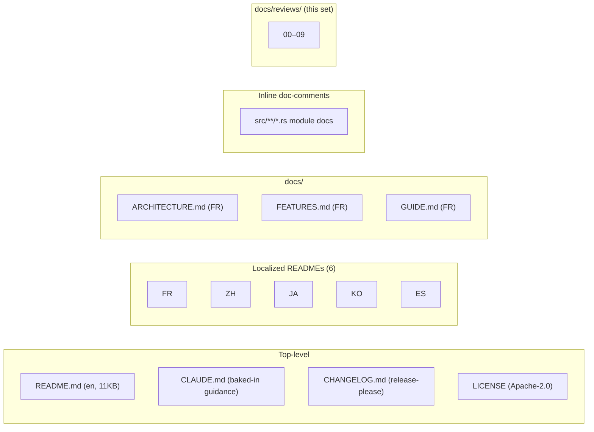
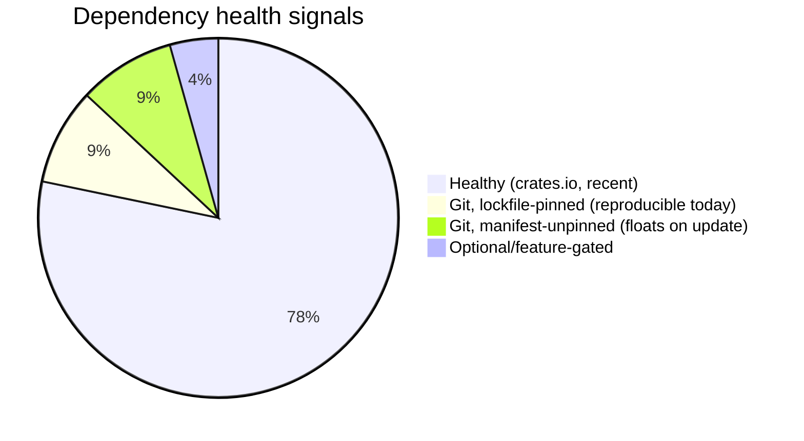
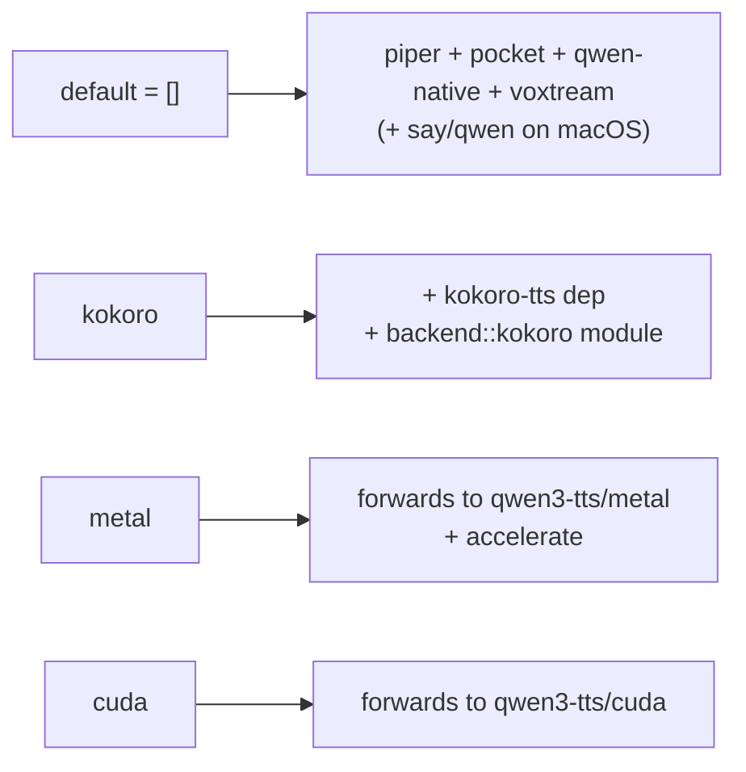

# Facet 8 — Documentation & Dependencies

**Subject:** `rtk-ai/vox` @ `9597c2f`
**Lens:** documentation accuracy/completeness, dependency table & hygiene, feature flags, Cargo.lock.

---

## 1. Documentation inventory

All `docs/` content is written in **French** (the author's primary language). The English README is the canonical user-facing doc. This split is consistent but means English-only contributors must read French for architecture details.

---

## 2. Documentation accuracy audit — README vs code

The English README (`README.md`) was updated for the 0.15.0 pocket release and is **the most accurate doc**. Every other doc lags.

```mermaid
%%{init: {"theme": "default"}}%%
flowchart TD
    classDef ok fill:#dcfce7,stroke:#16a34a
    classDef drift fill:#fee2e2,stroke:#dc2626
    classDef partial fill:#fef3c7,stroke:#a16207

    README["README.md<br/>'seven backends'"]:::ok
    LIBRS["src/lib.rs doc-comment<br/>'Four backends'<br/>(say/qwen/qwen-native/kokoro)"]:::drift
    ARCH["docs/ARCHITECTURE.md<br/>'quatre backends'<br/>lists only 4"]:::drift
    FEAT["docs/FEATURES.md<br/>examples use kokoro default<br/>no pocket"]:::drift
    GUIDE["docs/GUIDE.md<br/>install/backends mostly ok"]:::partial
    HB["Homebrew formula desc<br/>'three backends'"]:::drift
    MCP["mcp.rs tool schema<br/>omits pocket from backend enum"]:::drift
    TUI["tui.rs backend list<br/>omits pocket & kokoro"]:::drift
```

### 2.1 Concrete drift findings

| # | Doc | Claim | Reality | Severity |
|---|---|---|---|---|
| DR1 | `src/lib.rs:1-5` | "Four backends: say, qwen, qwen-native, kokoro" | **7 backends** (adds piper, pocket, voxtream); pocket is the *default* | medium |
| DR2 | `docs/ARCHITECTURE.md:5,12-18,46-53` | "quatre backends interchangeables"; table lists say/qwen/qwen-native/kokoro only; "Defaut Linux/Windows: kokoro" | 7 backends; default is `pocket` (`config.rs:5`); lang-aware default to piper for non-en (`config.rs:10-15`) | medium |
| DR3 | `docs/ARCHITECTURE.md:201` | backends table says macOS=`[kokoro, say, qwen, qwen-native]`, others=`[kokoro, qwen-native]` | actual `supported_backends()` always includes `piper, pocket, voxtream` + platform ones (`mod.rs:57-68`) | medium |
| DR4 | `docs/FEATURES.md` | examples assume `kokoro` is default; no mention of pocket/piper/voxtream | pocket is default; kokoro is opt-in feature | medium |
| DR5 | Homebrew formula `desc` (`release.yml:223`) | "three backends" | seven | low |
| DR6 | `mcp.rs:230-233` tool schema | backend enum: `kokoro, say, qwen, qwen-native, voxtream` | omits `pocket` (the default!) | **high** (already in Facet 7) |
| DR7 | `tui.rs:53-65` | backend list omits pocket, kokoro, piper-on-non-mac | omits the *default backend* | **high** (already in Facet 7) |
| DR8 | `README.md` benchmark table | lists `pocket` as "TBD" for M2 Pro / RTX | still TBD post-0.15.0 — acceptable but stale | low |
| DR9 | `README.md:214` | "Works with qwen, qwen-native, and voxtream backends" (voice cloning) | also pocket (`pocket.rs:135-145`) | low |
| DR10 | `docs/ARCHITECTURE.md:244-267` | "Binaires: aarch64-apple-darwin, x86_64-apple-darwin (metal)..." | Intel Mac removed (`release.yml:40-41`); aarch64-linux added | medium |
| DR11 | `CLAUDE.md` baked block | hardcodes `vox -l fr "..."` French instruction | conflicts with the MCP layer's localization work (commit `ac63bf1`) | medium |
| DR12 | Localized READMEs (fr/zh/ja/ko/es) | condensed versions, pre-pocket | no mention of pocket/piper-default | medium |

### 2.2 What's accurate & good

- **README install section** matches `install.sh` (`VOX_INSTALL_DIR`, Homebrew, curl|sh, from-source with features). ✅
- **README daemon section** matches `daemon.rs` (port 19876, idle timeout, voxtream-server proxy). ✅
- **CHANGELOG.md** is auto-maintained by release-please and accurate per release. ✅
- **`docs/ARCHITECTURE.md` MCP protocol section** (lifecycle, 14 tools) is accurate. ✅
- **Inline `src/` module doc-comments** are mostly accurate at the module level (e.g. `pocket.rs:1-14` correctly documents the HF_TOKEN/public-weights fall-back). ✅

---

## 3. Dependency deep-dive

### 3.1 Runtime dependency table (full)

| Dep | Ver | Source | Optional? | Purpose | Concern |
|---|---|---|---|---|---|
| clap | 4 | crates | no | CLI | — |
| anyhow | 1 | crates | no | errors | — |
| rusqlite | 0.32 | crates (`bundled`) | no | SQLite | `bundled` → static sqlite, good for distro |
| dirs | 6 | crates | no | paths | — |
| reqwest | 0.12 | crates (`blocking,json,stream`) | no | HTTP | dual blocking+async; inflates binary |
| tokio | 1 | crates (`rt,rt-multi-thread,net,io-util,macros,signal,time`) | no | async runtime | `macros`+`signal` likely unused (Facet 3 §6) |
| futures-util | 0.3 | crates | no | SSE stream | — |
| serde | 1 | crates (`derive`) | no | ser/deser | — |
| serde_json | 1 | crates | no | JSON | — |
| tempfile | 3 | crates | no | temp files | — |
| rodio | 0.20 | crates | no | audio | — |
| hound | 3 | crates | no | WAV | — |
| qwen3-tts | git | **github.com/TrevorS/qwen3-tts-rs** | no | qwen-native backend | **unpinned in manifest** (Facet 5 §2.2) |
| piper-rs | git | **github.com/thewh1teagle/piper-rs** | no | piper backend | **unpinned in manifest** |
| include_dir | 0.7 | crates | no | embed espeak data | — |
| kokoro-tts | 0.3 | crates | **yes** (`kokoro` feature) | kokoro backend | — |
| toml | 0.8 | crates | no | models.toml | — |
| ratatui | 0.29 | crates | no | TUI | — |
| crossterm | 0.28 | crates | no | TUI backend | — |
| pocket-tts | 0.6.2 | crates | no | pocket backend (default!) | — |
| sys-locale | 0.3 | crates | no | MCP locale | — |
| assert_cmd | 2 | crates | dev | CLI tests | — |
| predicates | 3 | crates | dev | matchers | — |
| tempfile | 3 | crates | dev | test fixtures | (dup of runtime — fine) |

### 3.2 Dependency hygiene findings

| # | Finding | Severity |
|---|---|---|
| DE1 | **`qwen3-tts` and `piper-rs` git deps lack `rev=`/`tag=`** in `Cargo.toml`. `Cargo.lock` pins them today, but `cargo update` floats; `Cargo.toml` alone doesn't capture intent. (Facet 5 §2.2.) | high |
| DE2 | **Transitive tree is large** (611 `Cargo.lock` entries) — driven by candle/ort/cpal. Not unusual for an ML-audio CLI, but worth a periodic `cargo machete`/`cargo udeps` sweep for unused direct deps. | low |
| DE3 | **No license audit.** vox is Apache-2.0; a future transitive GPL dep (e.g. via a git dep's update) could contaminate. `cargo deny check licenses` would catch. | medium |
| DE4 | **No advisory audit.** `cargo audit` not in CI. | high (Facet 4 SP2) |
| DE5 | **`tokio` features `macros` + `signal` may be unused.** Removing unused features trims compile time. Verify with `cargo build --timings`. | low |
| DE6 | **`reqwest` blocking+stream**: legitimate (CLI blocking, SSE async) but could be split if vox ever modularizes. | info |
| DE7 | **No version of `rusqlite` is bundled with a known-bad SQLite** — `bundled` builds latest amalgamation at crate release; fine. | ✅ |
| DE8 | **`Cargo.lock` is committed** ✅ — correct for a binary crate (ensures reproducible installs via `cargo install --locked`). | ✅ |

---

## 4. Feature flags

| # | Finding | Severity |
|---|---|---|
| FF1 | **Default build has no GPU acceleration** — `metal`/`cuda` must be opted-in. The prebuilt macOS release uses `metal` (`release.yml:37`), Linux CPU build uses none, Linux/Windows CUDA builds use `cuda`. Documented in README. ✅ | ✅ |
| FF2 | **`kokoro` is opt-in**, not in default — but `supported_backends()` includes it only when the feature is on (`mod.rs:60-61`). Consistent. ✅ | ✅ |
| FF3 | **No `default-features = false` discipline on `qwen3-tts`** — it *is* set (`Cargo.toml` `default-features = false`), good. ✅ | ✅ |
| FF4 | **Feature combinations untested in CI** — there's no `kokoro+metal` or `kokoro+cocoua` matrix entry. `kokoro` is never built in CI at all (no matrix entry enables it). The `kokoro` code path ships **uncompiled in CI**. | **high** |
| FF5 | **`metal` feature implies `accelerate`** (Apple's vec lib). On non-macOS this feature is meaningless but not guarded — `cargo build --features metal` on Linux would try to link accelerate and fail. A `#[cfg(target_os="macos")]` guard on the feature would help. | low |

---

## 5. Inline documentation quality

`src/` module-level doc-comments are present on **every** module (24/24). Quality is generally high:

- `pocket.rs:1-14` — exemplary: explains both HF weight sets, the fall-back logic, the public-vs-gated trade-off.
- `daemon.rs:1-9` — clear high-level purpose.
- `build.rs:1-10` — explains *why* the espeak-ng-data embedding exists (the hard-coded path problem).
- `chat/streaming.rs:262-267` — documents the crossfade intent.

| # | Finding | Severity |
|---|---|---|
| DC1 | **`lib.rs:1-5` doc is the most-visible stale doc** — `cargo doc` front page says "Four backends". Fix is one line. | medium (DR1) |
| DC2 | **Few `// SAFETY:` rationales** beyond `piper.rs:58-63` (which is debatable — Facet 2 PP3). The crate has 1 `unsafe` block total. ✅ Low unsafe surface. | ✅ |
| DC3 | **No `# Examples` in doc-comments** — public API (`SpeakOptions`, `TtsBackend`) has no runnable doctests. Acceptable for a binary crate. | low |
| DC4 | **`panic=abort`** means panics in doc-example code would abort `cargo test --doc` — but there are no doctests to worry about. | info |

---

## 6. README structure & clarity

The README is well-organized: banner → badges → language switcher → ASCII architecture → backends table → benchmark → install → usage → MCP → daemon → dev. ✅

| Section | Quality | Note |
|---|---|---|
| Backends table | high | accurate, includes latency/clone/platform/quality |
| Benchmark table | medium | several "TBD" cells; warm/cold distinction is useful |
| Install | high | matches install.sh; covers VOX_INSTALL_DIR |
| Usage examples | high | covers CLI, MCP, daemon, cloning |
| Dev section | medium | mentions `cargo b/r/t` aliases + features; no CONTRIBUTING.md |

**Missing docs:**
- No `CONTRIBUTING.md` (commit conventions, how to add a backend, test expectations).
- No `SECURITY.md` (reporting a vuln; the daemon's local surface deserves a note).
- No env-var reference (VOX_CONFIG_DIR, VOX_DB_PATH, VOX_DAEMON_PORT, HF_TOKEN, ANTHROPIC_API_KEY are all undocumented in one place).

---

## 7. Recommendations (ranked)

| # | Action | Effort | Addresses |
|---|---|---|---|
| R1 | Update `lib.rs` doc-comment to "seven backends" + list them | XS | DR1 |
| R2 | Update `docs/ARCHITECTURE.md` + `FEATURES.md` to 7 backends, pocket default, piper lang-fallback; fix the supported-backends table | S | DR2-4 |
| R3 | Add `kokoro` to the CI matrix (at least one entry) | XS | FF4 |
| R4 | Pin git deps with `rev=` | XS | DE1 |
| R5 | Add `CONTRIBUTING.md` + `SECURITY.md` + an env-var reference doc | S | §6 |
| R6 | Refresh localized READMEs (pocket default) | S | DR12 |
| R7 | Add `cargo audit` + `cargo deny` (license + advisory + ban git-unpinned) | S | DE3/4 |
| R8 | Trim unused tokio features (`macros`,`signal`) after verifying | XS | DE5 |
| R9 | Fix Homebrew formula `desc` ("seven backends") + remove Intel branch | XS | DR5, Facet 5 RL4 |
| R10 | Localize baked `CLAUDE.md` block or align with MCP instructions fix | XS | DR11 |

---

## 8. Bottom line

vox's documentation is **substantive and well-structured** — a thorough README, six localized translations, three architecture/feature/guide docs, auto-maintained changelog, and per-module doc-comments. The weakness is **drift**: every doc except the English README still describes the pre-0.15 world of four backends, and the two highest-traffic machine-read docs (the MCP tool schema and the TUI backend list) omit the *default* backend. The dependency story is healthy on crates.io but has two unpinned git deps and no audit gate. R1–R4 are a few hours and close the most embarrassing gaps; R3 (build `kokoro` in CI) closes a real "ships uncompiled" risk.
