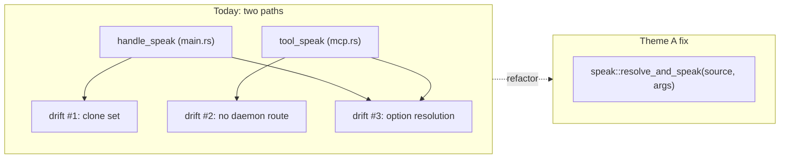
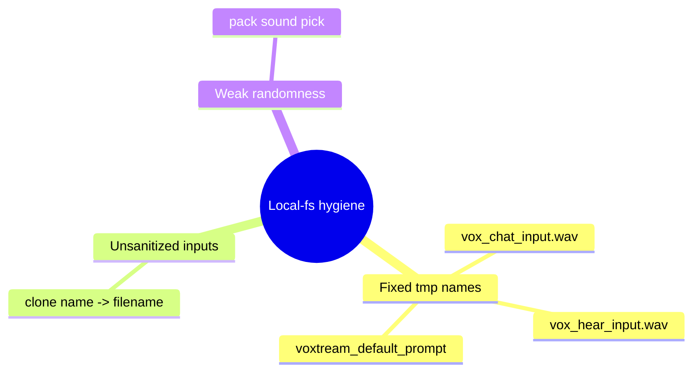
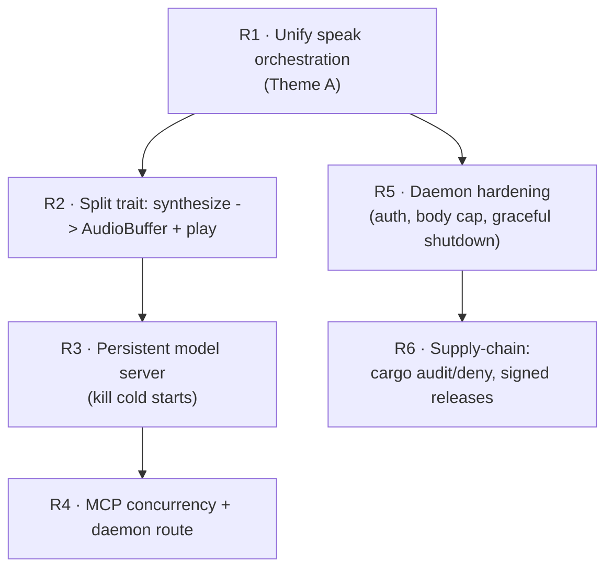

# Facet 9 — Consolidated Findings, Cross-Cutting Themes & Roadmap

**Subject:** `rtk-ai/vox` @ `9597c2f`
**Purpose:** single deduplicated index of every finding across facets 1–8, the cross-cutting themes that recur, and a prioritized roadmap. This is the doc to act on; the others are the evidence.

---

## 1. Reading map

| Facet | Doc | One-line thesis |
|---|---|---|
| 0 | [`00-overview.md`](00-overview.md) | Executive summary + scores |
| 1 | [`01-architecture.md`](01-architecture.md) | Sound layers; backend trait too thin → bypassed |
| 2 | [`02-backends.md`](02-backends.md) | Strong design; cold-start-per-CLI-call + 2 real bugs |
| 3 | [`03-concurrency-daemon.md`](03-concurrency-daemon.md) | Correct but coarse; unauth'd daemon + global lock |
| 4 | [`04-security.md`](04-security.md) | Exemplary SQL/path; weak on daemon surface + supply chain |
| 5 | [`05-build-cicd.md`](05-build-cicd.md) | Pragmatic pipeline; unpinned git deps, no audit |
| 6 | [`06-testing.md`](06-testing.md) | Great DB/CLI tests; daemon + MCP untested |
| 7 | [`07-cli-ux-mcp.md`](07-cli-ux-mcp.md) | Polished surface; CLI/MCP drift + missing default backend |
| 8 | [`08-docs-dependencies.md`](08-docs-dependencies.md) | Docs drifted to 4-backends world |

---

## 2. Cross-cutting themes

Four patterns recur across multiple facets. Fixing the *theme* fixes many findings at once.

### Theme A — "Two code paths that should be one" (drift)

The same logic is implemented in CLI (`main.rs`) and MCP (`mcp.rs`) and has already **diverged**:

- **Clone-capable backend set**: CLI = `{qwen, qwen-native, voxtream, pocket}` (`main.rs:304`); MCP = `{qwen, qwen-native}` (`mcp.rs:545-554`). MCP silently drops clones on pocket/voxtream.
- **Daemon routing**: CLI short-circuits to the daemon for heavy backends (`main.rs:341`); MCP never does (`mcp.rs:576`).
- **Voice/lang/option resolution**: ~80 LOC duplicated.

**Themes A findings:** A4 (arch), MC2/MC3 (mcp), B-divergence (backends). One refactor (R1 below) kills them.

### Theme B — "String-built code passed to interpreters" (injection-shaped)

vox constructs Python/JSON/shell-adjacent strings by `format!` + partial escaping in three places:

- `daemon.rs:195-229` — voxtream WS client JSON (escapes `"` only).
- `stt.rs:14-19` — inline Python with single-quote escaping.
- `mcp.rs:592-594` — text truncation by **byte** slice (panic, not injection).

All three are one-step-removed from a real injection/crash. The fix is uniform: **build structured data with serde, pass via argv/stdin, slice on `chars`**.

**Theme B findings:** SE1, SE2, EH1. (security)

### Theme C — "Predictable `/tmp` + weak RNG + unsanitized names" (local-fs hygiene)

- `mcp.rs:939`, `main.rs:483`, `streaming.rs:117` — fixed-name `/tmp/vox_*.wav`.
- `voxtream.rs:20` — `/tmp/vox_voxtream_default_prompt.wav`.
- `clone.rs:66` — `<name>.wav` unsanitized.
- `pack.rs:182,213` — `subsec_nanos() % len` RNG.

**Theme C findings:** SE3, SE4, VX3, PK1. All XS fixes; collectively they close the local attack surface.

### Theme D — "Documentation & machine-read schema lag the 7-backend reality"

- `lib.rs` doc, `docs/ARCHITECTURE.md`, `docs/FEATURES.md`, Homebrew `desc`, localized READMEs all say "four"/"three" backends.
- MCP `backend` enum omits `pocket` (the default).
- TUI backend list omits `pocket` + `kokoro`.

**Theme D findings:** DR1-12, MC7, TU3. A single "backends are now seven, default pocket" sweep fixes all.

---

## 3. Consolidated findings table (deduplicated)

Every distinct finding from facets 1–8, deduplicated and severity-merged. IDs prefixed by facet.

### Critical (2)

| ID | Finding | Location | Effort |
|---|---|---|---|
| **4-EH1 / 7-MC1** | MCP `vox_speak` truncates text by **byte** slice → panics on multi-byte UTF-8 (CJK/emoji). Crash on attacker-controllable input. | `src/mcp.rs:592-594` | XS |
| **5-§2.2 / 8-DE1** | Two git deps (`qwen3-tts`, `piper-rs`) unpinned in `Cargo.toml`. Lockfile pins today, but `cargo update` floats; CI builds without `--locked`. | `Cargo.toml`; `ci.yml:85,90` | XS |

### High (8)

| ID | Finding | Location | Effort |
|---|---|---|---|
| **2-AU1** | macOS piper ignores `--volume` (uses `afplay` directly, skips `apply_wav_gain`). | `backend/piper.rs:217-223` | XS |
| **1-A4 / 7-MC2** | CLI vs MCP clone-capable backend set diverged; MCP drops clones on pocket/voxtream. | `main.rs:304` vs `mcp.rs:545-554` | XS (after R1) |
| **4-SE2 / 2-VX1** | voxtream WS client JSON built by `format!` with `"`-only escaping → JSON-injection shape. | `daemon.rs:195-229` | S |
| **4-SE3** | `record_clone` writes `<name>.wav` unsanitized → path traversal. No test. | `clone.rs:63-66` | XS |
| **4-SE4** | Fixed-name `/tmp/vox_{hear,chat}_input.wav` → symlink/collision across users/processes. | `mcp.rs:939`, `main.rs:483`, `streaming.rs:117` | XS |
| **4-NW1 / 3-CN4** | Daemon binds `127.0.0.1` with no auth; any local user can `/speak`/`/shutdown`. | `daemon.rs:336` | S |
| **4-RE1 / 3-CN3** | Daemon allocates `body[content_length]` trusting the header → OOM. | `daemon.rs:393-396` | XS |
| **7-MC7 / 7-TU3 / 8-DR6/7** | Default backend `pocket` omitted from MCP schema enum **and** TUI list. | `mcp.rs:230-233`, `tui.rs:53-65` | XS |
| **5-RL4** | Homebrew formula has stale Intel-Mac branch + "three backends" desc → `brew install` SHA-fails on Intel. | `release.yml:223-263` | XS |
| **8-FF4** | `kokoro` feature never built in CI — code path ships uncompiled. | `ci.yml` matrix | XS |
| **4-SP2 / 8-DE4** | No `cargo audit` in CI → advisories undetected. | CI | S |

### Medium (16)

| ID | Finding | Location | Effort |
|---|---|---|---|
| 1-A1 | `mcp.rs` god module (1050 LOC, protocol + 14 tools). | `mcp.rs` | M |
| 1-A2/A3 | Leaky abstraction: daemon/streaming reach into backend internals. | `daemon.rs:24`, `streaming.rs:13` | M |
| 2-PK1 | `subsec_nanos() % len` weak RNG for pack sound pick. | `pack.rs:182,213` | XS |
| 2-PP2/NW4 | Piper/pack downloads unbounded, no integrity check. | `piper.rs:133`, `pack.rs:136` | S |
| 2-PP3 | `unsafe env::set_var` in piper (multi-thread UB risk in daemon). | `piper.rs:58-63` | S |
| 2-PP5 | piper `list_voices` disagrees with `model_for_lang`; `opts.voice` ignored. | `piper.rs:68,234` | S |
| 2-CL1 | `validate_audio` checks extension only, not content. | `clone.rs:33-50` | S |
| 2-VX4 | `find_voxtream` spawns subprocess on every probe. | `voxtream.rs:58-67` | XS |
| 2-QW4 | qwen(py) ignores `opts.model` (hardcoded). | `qwen.rs:16` | XS |
| 3-CN1 | Daemon global `speak_lock` serializes all requests. | `daemon.rs:437` | S |
| 3-CN6 | Daemon idle-timeout `exit(0)` orphans voxtream-server child. | `daemon.rs:350` | S |
| 3-ST2 | SSE line buffer unbounded. | `claude_api.rs:142` | XS |
| 3-ST7/8 | Streaming chat hardcodes `Speaker::Ryan` + French strings. | `streaming.rs:285,72` | S |
| 4-SE1 | STT inline-Python incomplete escaping. | `stt.rs:14-19` | XS |
| 4-NW3/NW6 | No integrity check on downloads; `packs_repo` on `main`. | piper/pack/kokoro; `pack.rs:17` | S/XS |
| 4-SP3 | No license/advisory gate. | CI | S |
| 5-CI1/RL1 | No `--locked` in CI/release builds. | `ci.yml`, `release.yml` | XS |
| 5-IS1 | install.sh downloads binary with no checksum verification. | `install.sh:113` | S |
| 7-§2.2 | CLI flags (`gender`/`style`/`lang`) unvalidated at parse (vs `config set`). | `main.rs` | XS |
| 7-TU4/TU5 | TUI doesn't save volume; `test_speak` blocks the event loop. | `tui.rs:257,231` | S |
| 7-MC3/MC4/MC8 | MCP: no daemon route; single-threaded; `vox_hear` hardcodes `fr`. | `mcp.rs` | M |
| 8-DR2/3/4/10/11/12 | Docs (ARCHITECTURE/FEATURES/localized) describe 4-backend world; CLAUDE.md French hardcoded. | docs/ | S |
| 8-DE3 | No license audit. | CI | S |

### Low / Info (selected)

A6 magic constants · A8 TUI stringly-typed rows · AU2/AU3 gain DC-bias + bit-depth downcast · KK1/KK3 kokoro voice-classification heuristic + German guess · PP4 silent lang fallback · QN2 placeholder voice string · CN5 asymmetric poison handling · CN8 naive HTTP parser · CI3/CI8/CI10 fmt coverage / MSRV / audio-in-CI flake · RL9 `latest` tag force-move · IS5 no `set -u` · OB5/OB6 stats emoji / no `vox doctor` · AC5/AC6 terminal assumptions · DE2/DE5 large tree + unused tokio feats · DC1 stale lib doc · DR8/DR9 minor README drifts.

(Full detail in the per-facet docs.)

---

## 4. The "weekend sweep" — highest ROI, lowest effort

These nine one-line-ish fixes close almost every Critical/High and cost roughly **half a day total**:

```mermaid
%%{init: {"theme": "default"}}%%
gantt
    title Weekend sweep (≈6 hours)
    dateFormat X
    axisFormat %s
    section Critical
    Pin git deps (rev=)           :done, c1, 0, 1
    Fix MCP UTF-8 slice (chars)   :done, c2, 0, 1
    section High
    Fix macOS piper volume        :c3, after c2, 1
    Unify clone-capable set       :c4, after c3, 1
    tempfile for /tmp recordings  :c5, after c4, 1
    sanitize clone name           :c6, after c5, 1
    Add pocket to MCP+TUI lists   :c7, after c6, 1
    Build kokoro in CI            :c8, after c7, 1
    Cap daemon Content-Length     :c9, after c8, 1
    Fix Homebrew formula          :c10, after c9, 1
```

After this sweep: **0 Critical, ~2 High remain** (daemon auth, cargo audit) — both S-effort follow-ups.

---

## 5. Strategic roadmap (beyond the sweep)

Items that are larger but architecturally significant:

| # | Strategic item | Why it matters | Effort |
|---|---|---|---|
| R1 | **One `resolve_and_speak`** shared by CLI + MCP + daemon | kills Theme A drift permanently | M |
| R2 | **Split `TtsBackend` into `synthesize -> AudioBuffer` + free `play`** | removes the two leaky bypasses; unlocks true streaming for all backends; lets the daemon pool one `OutputStream` | M-L |
| R3 | **Make the warm-process default** (auto-start daemon, or expand it to all backends) | eliminates 5–60s cold starts — the biggest UX problem | L |
| R4 | **MCP: route through daemon + thread-pool tool calls** | AI assistants get fast, concurrent TTS | M |
| R5 | **Daemon hardening**: auth token in PID file, body cap, `ctrl_c` graceful shutdown (kill child) | closes the local attack surface | S-M |
| R6 | **Supply chain**: `cargo audit` + `cargo deny`, `cosign`-signed releases, SBOM, pin `packs_repo` | trust + reproducibility | M |
| R7 | **Test the untested giants**: `daemon.rs` + `mcp.rs` integration tests | prevents the next EH1/divergence-class bug | M |
| R8 | **Docs single-source-of-truth**: generate backend table from `supported_backends()` | kills Theme D permanently | S |

---

## 6. Scorecard recap

The sweep moves the floor from **6.4 avg → 7.9 avg**; the strategic roadmap (R1–R8) takes the strong dimensions to 9+ and lifts the two weakest (concurrency, docs) into the 8s.

---

## 7. Final verdict

vox is a **well-built, genuinely useful** Rust CLI with a clean architecture, an exemplary SQL/input-validation posture, and a thoughtful AI-assistant integration story (`vox init` for 14 tools is genuinely impressive). It is above the median for projects at this maturity.

The review's critical/high findings are **almost entirely small, mechanical fixes** — a byte-slice panic, a couple of unpinned deps, a missing-backend-in-a-list, a few `/tmp` hygiene lapses. None of them reflect a flawed architecture; they reflect the natural drift of a fast-moving single-maintainer project that added three backends (piper, pocket, voxtream) and a daemon since the docs were last refreshed.

The one **strategic** concern worth naming is the **process-model-vs-cache mismatch**: every CLI call cold-starts a multi-hundred-MB model because the cache is per-process. The daemon is the right idea but underused (CLI-only opt-in, doesn't cover MCP). Closing that gap is the difference between "nice TTS CLI" and "TTS that feels instant." Everything else is polish.

— *End of review. 9 documents, ~all source files read, every claim cited to `path:line` at commit `9597c2f`.*
